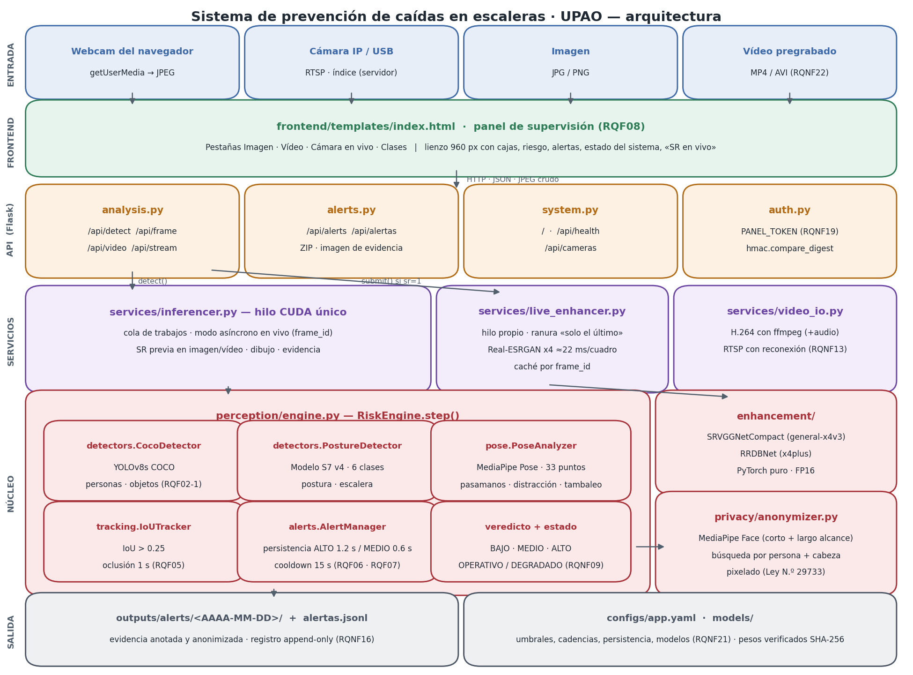
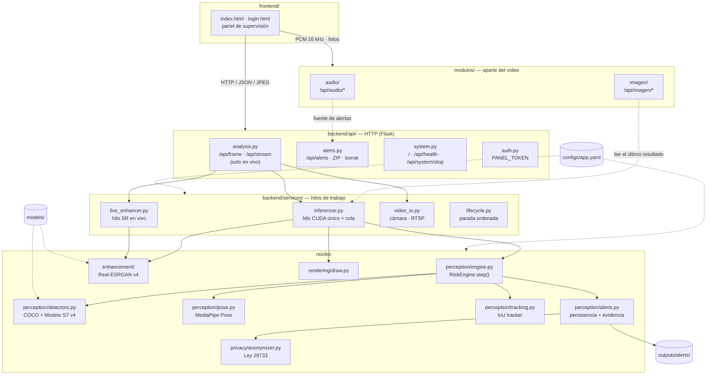
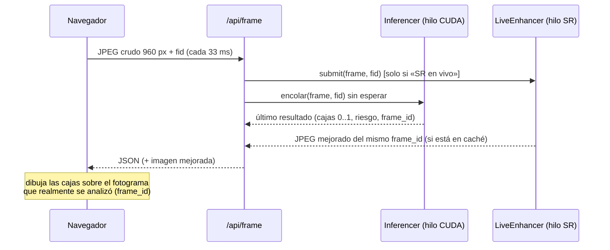

# Sistema de prevención de caídas en escaleras · UPAO

Sistema de visión por computadora que vigila una escalera con una cámara fija y
avisa al personal de seguridad cuando detecta una situación de riesgo:
**caídas, pérdida de equilibrio, tránsito sin usar el pasamanos, distracción con
el celular y objetos abandonados en los escalones**. Incluye un panel web con la
cámara en vivo y una opción de **mejora de calidad de vídeo (Real-ESRGAN x4)**
que funciona de forma fluida en tiempo real.

El vídeo trabaja **solo en vivo** (no se suben vídeos ni imágenes al motor de
vídeo). Junto a él hay dos **módulos aparte**, integrados desde los repositorios
de los otros grupos sin modificar el vídeo:

- **`modulos/audio/`** — percepción acústica: pisadas, carrera, impacto de caída,
  gritos / pedido de auxilio y clasificador ML de caídas (pestaña **🎙 Audio**).
- **`modulos/imagen/`** — análisis de fotografías y fotogramas con YOLO11 +
  YOLO11-Pose, calidad óptica y preprocesamiento adaptativo (pestaña **🖼 Imagen**).

Funciona en una **GTX 1650 (4 GB)**: el perfil `baja_vram` se activa solo (§4.5)
y el panel tiene un botón **«Detener sistema»** que apaga todo de forma ordenada.

> Universidad Privada Antenor Orrego · Curso de Percepción Computacional · 2026
> Rama `expo` · Modelo **S7 v4** (release `v1.2.0-escaleras-v4`, definitivo, no se reentrena)



---

## Índice

1. [Qué hace](#1-qué-hace)
2. [Instalación](#2-instalación)
3. [Uso](#3-uso)
4. [Arquitectura del sistema](#4-arquitectura-del-sistema)
5. [Arquitectura de los modelos](#5-arquitectura-de-los-modelos)
6. [Funciones y cómo se implementan](#6-funciones-y-cómo-se-implementan)
7. [Decisiones: qué se implementó, por qué, y qué se descartó](#7-decisiones-qué-se-implementó-por-qué-y-qué-se-descartó)
8. [Privacidad: Ley N.º 29733 y anonimización](#8-privacidad-ley-n-29733-y-anonimización)
9. [Normas ISO/IEC aplicadas](#9-normas-isoiec-aplicadas)
10. [Cumplimiento de requisitos](#10-cumplimiento-de-requisitos)
11. [Estructura del repositorio](#11-estructura-del-repositorio)
12. [API HTTP](#12-api-http)
13. [Pruebas](#13-pruebas)
14. [Datos, créditos y licencias](#14-datos-créditos-y-licencias)
15. [Limitaciones conocidas](#15-limitaciones-conocidas)

---

## 1. Qué hace

| Lo que pide el cliente | Cómo lo resuelve el sistema |
|---|---|
| Ver en la interfaz a las personas caminando por la escalera (cámara en vivo) | Pestaña **Cámara en vivo**: la webcam del navegador (o una cámara IP vía `/api/stream`) se analiza a ~30 fps y las cajas se dibujan sobre el vídeo. |
| Detectar **persona de pie erguida** | Clase `persona_erguida` (riesgo BAJO) por geometría de pose (MediaPipe) o por el detector propio. |
| Detectar **pérdida de equilibrio** | Clase `persona_desequilibrio` + señal `tambaleo` (inclinación del tronco > 12°, asimetría de rodillas). Riesgo ALTO. |
| Detectar **persona distraída** | Señal `distraccion`: mano junto a la cara con cabeza inclinada, o un **celular** (COCO) a menos de 0.14 del rostro. Riesgo MEDIO. |
| Detectar **no uso del pasamanos** | Señal `sin_pasamanos`: ninguna muñeca a la altura de la barandilla y brazo separado del tronco. Riesgo MEDIO. |
| Detectar **anomalías en la escalera** (objetos, estorbos) | YOLOv8s COCO: mochila, bolso, maleta, botella, libro, paraguas → `obstaculo_escalon` (ALTO); mobiliario como contexto. |
| Opción para ver la imagen en vivo **con mejora de calidad** | Casilla **«Mejora de calidad (Real-ESRGAN x4)»**: Real-ESRGAN x4 (`realesr-general-x4v3`) en un hilo propio, ~22 ms por cuadro → el vídeo mejorado se ve fluido (~29 fps medidos). |
| Solo vídeo en vivo | Se eliminaron las pestañas y rutas de imagen y vídeo **subidos** (`/api/detect`, `/api/video`) y el modelo de SR que solo usaban ellas. |
| Funcionar en una **GTX 1650** | Perfil `baja_vram` automático: Real-ESRGAN en FP32 y entrada de 320 px. Pico medido con todo activo: **0.32 GB de VRAM** (§4.5). |
| Integrar el **audio** del grupo de audio | `modulos/audio/` + pestaña **🎙 Audio**: todas sus funciones activas (§4.6). |
| Integrar el **módulo de imagen** | `modulos/imagen/` + pestaña **🖼 Imagen**, que reemplaza a la antigua pestaña Imagen (§4.6). |
| Función interna para **parar el proyecto** | `Lifecycle.shutdown()`: botón «Detener sistema», `python -m backend --stop` o Ctrl+C (§3). |

Además: alertas con evidencia fotográfica **anonimizada**, registro auditable,
autenticación del panel y estado operativo visible.

---

## 2. Instalación

Requisitos: **Python 3.10 – 3.12**, Linux / WSL2 / macOS / Windows. GPU NVIDIA
opcional (recomendada; mínimo probado: perfil de **GTX 1650, 4 GB**). Todo se instala **dentro de un entorno
virtual**: no se ensucia el sistema.

### 2.1 Instalación automática (Linux / WSL2)

```bash
git clone https://github.com/AndyHHR1/Video-G-G.git
cd Video-G-G
git checkout expo

scripts/setup.sh            # venv estándar  (.venv)
# o bien
scripts/setup.sh --lambda   # si usas Lambda Stack (reutiliza paquetes del sistema)
# o bien
scripts/setup.sh --cpu      # sin GPU NVIDIA
```

El script detecta la GPU, instala PyTorch correcto, las dependencias, descarga y
verifica (SHA-256) los modelos y ejecuta un diagnóstico.

### 2.2 Instalación manual con **Lambda Stack**

Lambda Stack ya trae CUDA, TensorFlow y un PyTorch de sistema. Se crea el venv
**con acceso a los paquetes del sistema**:

```bash
python3 -m venv --system-site-packages .venv
source .venv/bin/activate
export PYTHONNOUSERSITE=1          # que no se cuelen paquetes de ~/.local

pip install --upgrade pip
pip install --ignore-installed "flatbuffers>=2.0"   # ver nota 1
pip install -r requirements/torch-cu128.txt         # ver nota 2
pip install -r requirements/base.txt
pip install -r requirements/modulos.txt             # audio e imagen
python tools/download_models.py
python tools/check_env.py
```

> **Nota 1 – flatbuffers.** Lambda Stack instala un `flatbuffers` de Debian con
> versión `1.12.1-git…`, que pip ≥ 24.1 rechaza (`invalid-installed-package`).
> Uno válido dentro del venv tiene prioridad y lo resuelve.
>
> **Nota 2 – PyTorch.** El PyTorch de Lambda Stack no trae kernels para GPUs
> **Blackwell (RTX 50xx, `sm_120`)**: `torch.cuda.is_available()` devuelve
> `False`. Por eso se instala `torch 2.11.0+cu128` dentro del venv, que tiene
> prioridad sobre el del sistema. Esa build trae kernels desde **`sm_75`**
> (Turing), así que también sirve tal cual para una **GTX 1650** (driver NVIDIA
> ≥ 570, el mínimo de CUDA 12.8).
>
> **Nota 3 – TensorFlow del sistema.** mediapipe importa el TensorFlow de Lambda
> Stack y éste carga su propia NCCL; si eso ocurre antes que torch, torch falla
> con `undefined symbol: ncclCommShrink`. El backend importa torch primero
> (`backend/__init__.py`), así que no hay que hacer nada; solo tenerlo en
> cuenta si se escriben scripts propios.

### 2.3 Instalación manual con **venv estándar** (sin Lambda)

Linux / macOS:

```bash
python3 -m venv .venv
source .venv/bin/activate
pip install --upgrade pip
pip install -r requirements/torch-cu128.txt     # GPU NVIDIA
# pip install -r requirements/torch-cpu.txt    # sin GPU (o macOS)
pip install -r requirements/base.txt           # incluye lap (ByteTrack de los esqueletos)
pip install -r requirements/modulos.txt        # audio e imagen
python tools/download_models.py
```

Windows (PowerShell):

```powershell
py -3.11 -m venv .venv
.\.venv\Scripts\Activate.ps1
python -m pip install --upgrade pip
pip install -r requirements\torch-cu128.txt     # o requirements\torch-cpu.txt
pip install -r requirements\base.txt
pip install -r requirements\modulos.txt
python tools\download_models.py
```

### 2.4 Verificar

```bash
python tools/check_env.py
```

Muestra versiones, GPU, VRAM, si PyTorch trae kernels para esa GPU, el perfil
de hardware que se usará, las dependencias de los módulos y el hash de cada modelo.

---

## 3. Uso

```bash
scripts/run.sh                       # equivalente a: python -m backend
# abrir http://127.0.0.1:5000
```

| Opción | Efecto |
|---|---|
| `--host 0.0.0.0 --port 5000` | Escuchar en la red local (por ejemplo, para verlo desde el celular) |
| `--device cpu` / `--device 0` | Forzar CPU o una GPU concreta (`auto` por defecto) |
| `--sr` / `--no-sr` | Forzar o apagar la mejora Real-ESRGAN (`auto`: activa si hay GPU) |
| `--profile baja_vram` | Forzar el perfil de GTX 1650 (`auto` lo elige solo) |
| `--no-audio` / `--no-imagen` | Arrancar sin uno de los módulos aparte |
| `--stop` | Detener un servidor que ya está corriendo y salir |
| `--conf 0.3` | Umbral por defecto del detector |
| `--set clave.sub=valor` | Cambiar cualquier valor de `configs/app.yaml` sin editarlo |
| `--config otro.yaml` | Usar otra configuración (por ejemplo, otra escalera) |

**Autenticación (RQNF19):** si se define `PANEL_TOKEN`, el panel pide ese token.

```bash
PANEL_TOKEN="un-secreto-largo" scripts/run.sh --host 0.0.0.0
```

**Cámara de seguridad IP:** en `configs/app.yaml` → `camera.source:
"rtsp://usuario:clave@ip:554/stream"`, y abrir `http://servidor:5000/api/stream`.

**Pestañas del panel:**

- **Cámara en vivo:** webcam del navegador. La casilla **«Mejora de calidad (Real-ESRGAN x4)»** activa la mejora en tiempo real (~29 fps). Sus alertas incluyen también las acústicas (marcadas «audio»).
- **🎙 Audio** (módulo `modulos/audio`): micrófono en vivo con vúmetro y métricas (pisadas/s, factor de cresta, F0, pico RMS), sensibilidad alta/media/baja, pitido y notificaciones, demostración con la sesión simulada de `final.py` y análisis de un archivo **de audio**. Puede funcionar a la vez que la cámara.
- **🖼 Imagen** (módulo `modulos/imagen`): fotografía o cámara; calidad óptica, preprocesamiento (adaptativo / original / CLAHE / gamma), personas y celulares (YOLO11n), articulaciones (YOLO11n-Pose) y el JSON completo. «Características del vídeo en vivo» lee el último fotograma del vídeo sin alterarlo.
- **Clases:** leyenda de clases y su relación con los requisitos.

**Detener el sistema** (función interna de parada, `backend/services/lifecycle.py`):

| Cómo | Qué hace |
|---|---|
| Botón **«⏻ Detener sistema»** del panel | Cierra en el navegador cámara, micrófono y cámara de Imagen; luego `POST /api/system/stop` |
| `python -m backend --stop` | Pide la parada a un servidor en marcha (usa `PANEL_TOKEN` si está definido) |
| Ctrl+C / `SIGTERM` | Misma parada ordenada desde la consola |

En todos los casos se deja de aceptar trabajo nuevo (las rutas `/api/*` responden
503), se cierran las sesiones de audio, se liberan los modelos de imagen, se
detienen la mejora en vivo y el hilo de inferencia (vaciando la memoria de la
GPU) y, por último, el servidor HTTP. Sin `PANEL_TOKEN`, la parada por HTTP solo
se acepta desde el propio equipo.

> `getUserMedia` (webcam) solo funciona en un origen seguro: abrir en
> `http://localhost:5000` o servir por HTTPS. Sin HTTPS no hay cifrado: usar
> solo en redes de confianza.

---

## 4. Arquitectura del sistema

### 4.1 Capas

El código está dividido en capas con dependencias en un solo sentido
(arriba → abajo). Ninguna capa inferior conoce a las superiores.



| Capa | Carpeta | Responsabilidad |
|---|---|---|
| Presentación | `frontend/` | Panel web (HTML + JS). No contiene lógica de visión. |
| API | `backend/api/` | Traducir HTTP ↔ llamadas a servicios. Validar entradas. Autenticación. |
| Servicios | `backend/services/` | Concurrencia: hilo de inferencia, hilo de SR en vivo, cámara, ciclo de vida (parada). |
| Hardware | `backend/hardware.py` | Detecta la GPU y aplica el perfil `baja_vram` (GTX 1650). |
| Módulos aparte | `modulos/audio/`, `modulos/imagen/` | Audio e imagen de los otros grupos. Se cargan aislados: si fallan, el vídeo sigue. |
| Percepción | `backend/perception/` | Motor de riesgo: detectores, pose, seguimiento, persistencia, alertas. |
| Mejora | `backend/enhancement/` | Superresolución Real-ESRGAN (arquitecturas en PyTorch puro). |
| Privacidad | `backend/privacy/` | Anonimización de rostros antes de escribir cualquier imagen. |
| Dibujo | `backend/rendering/` | Cajas, etiquetas y codificación JPEG. |
| Configuración | `configs/app.yaml` + `backend/config.py` | Todos los umbrales y rutas, sin tocar código. |

### 4.2 Flujo de la cámara en vivo



Claves del diseño:

- **Un único hilo CUDA para la inferencia.** Flask atiende cada petición en un hilo nuevo y CUDA tiene que reenlazar su contexto en cada uno (medido: 82 ms frente a 29 ms). Todos los modelos viven en un hilo persistente y las peticiones le encolan trabajo.
- **Modo asíncrono en vivo.** La petición devuelve al instante el último resultado y el motor sigue a su ritmo: el navegador nunca espera a la inferencia.
- **La mejora va en paralelo.** La superresolución no pasa por el hilo de detección; corre en su propio hilo y se empareja por `frame_id`.
- **Cadencias coprimas.** Cada etapa se ejecuta cada N fotogramas (pose 8, personas 6, escalera 13, obstáculos 11, clasificación 6) y reutiliza su último resultado entre medias; al ser coprimas casi nunca coinciden en el mismo fotograma y el coste es estable.

### 4.3 Pipeline de `RiskEngine.step()`

```
fotograma ─► 1 personas (YOLOv8s COCO) ──────────────┐
          ─► 2 escalera (Modelo S7 v4) ──────────────┤
          ─► 3 pose (MediaPipe) → señales ───────────┤
          ─► 4 objetos (YOLOv8s COCO) ───────────────┤
                                                     ▼
          5 postura por persona: geometría de pose (si es la persona emparejada)
                                 o recorte → Modelo S7 v4
          6 seguimiento IoU → identidad estable (RQF05)
            caída por recorte: MEDIO «REVISAR» hasta 3 fotogramas seguidos → ALTO
          7 celular junto a la cara → distracción (RQF02-3)
          8 persistencia por severidad + histéresis + cooldown → alerta (RQF06-07)
          9 veredicto BAJO / MEDIO / ALTO + estado OPERATIVO / DEGRADADO
```

### 4.4 Rendimiento medido (RTX 5070 Laptop, 8 GB, WSL2)

| Medida | Valor |
|---|---|
| Motor completo, 4 personas, 960×540 | **34 fps** (p50 27 ms, p95 42 ms) |
| Respuesta de `/api/frame` (asíncrono) | p50 4–5 ms |
| Cámara en vivo con «SR en vivo» | **~29 fps**, imagen mejorada en cada respuesta |
| Real-ESRGAN `general-x4v3`, 480→1920 px, FP16 | 22 ms (FP32: 50 ms) |
| Perfil GTX 1650 (FP32, 320 px), todo activo, GPU limitada a 3.6 GB | Real-ESRGAN 19 ms/cuadro · pico **0.32 GB** de VRAM |
| Módulo de audio (detector por reglas + MLP), bloque de 500 ms | ~165 ms de CPU por bloque |
| SR anterior (ONNX + onnx2torch, 320 px) | ~460 ms → ~2 fps |
| Anonimización de una evidencia | ~15 ms (solo en fotogramas con alerta) |

### 4.5 GTX 1650 (4 GB): perfil `baja_vram`

La GTX 1650 es Turing (`sm_75`) con 4 GB y sin Tensor Cores. La build
`torch 2.11.0+cu128` del proyecto ya trae kernels para `sm_75`, así que no hace
falta otra instalación. `backend/hardware.py` detecta la GPU al arrancar y, si
tiene ≤ 4.5 GB o es una GTX 16xx, aplica el perfil `baja_vram`
(`configs/app.yaml → hardware`):

| Ajuste | Normal | `baja_vram` | Por qué |
|---|---|---|---|
| `enhancement.half` (FP16 en Real-ESRGAN) | sí | **no** | Las GTX 16xx tienen fallos conocidos con media precisión (NaN / imagen negra) |
| `enhancement.live.input_max` | 480 px | **320 px** | ~2.2× menos trabajo de SR: deja GPU libre para la detección |
| Detección (S7 v4, 640 px) | igual | igual | El modelo se entrenó a 640 px y **no se reentrena** |
| Modelos de imagen (YOLO11) | carga en el primer uso | igual | No ocupan VRAM hasta que se usa la pestaña Imagen |

Además se quitó el modelo grande `RealESRGAN_x4plus` (16.7 M parámetros), que
solo servía a las imágenes/vídeos subidos. Medido en esta máquina con el perfil
forzado y la GPU limitada a 3.6 GB (`torch.cuda.set_per_process_memory_fraction`):
vídeo en vivo + mejora + módulo Imagen = **0.32 GB** de pico. El perfil se puede
forzar con `--profile baja_vram` o desactivar con `--profile normal`.

### 4.6 Módulos aparte: audio e imagen

Viven en `modulos/` y no importan nada del vídeo. Cada uno expone
`install(app, settings, runtime, options)`; `backend/app.py` los carga al final
dentro de un `try`: si uno falla (por ejemplo, faltan sus dependencias) el panel
lo marca «no disponible» y el vídeo sigue igual.

**Audio** — de [brigitteve/percepcion](https://github.com/brigitteve/percepcion).
Se trajo solo la parte acústica; **su versión antigua de vídeo no se migró**.

| Función | Archivo |
|---|---|
| Captura del micrófono en el navegador: AudioWorklet, mono 16 kHz, bloques de 500 ms | `static/audio-worklet.js`, `static/audio-live.js` |
| Panel: vúmetro, métricas en vivo, sensibilidad, pitido, notificaciones, alertas | `static/audio-panel.js`, `templates/audio/panel.html` |
| Detector por reglas de `final.py`: pisadas/cadencia (caminando / corriendo), impacto (pico RMS + factor de cresta), grito / auxilio (F0 con pYIN) | `acoustic_perception.py` |
| Clasificador ML de caídas: disparador RMS, MLP calibrado de 6 clases, vetos, evaluación de los 7 s posteriores y fusión | `audio_fall_detector/` (modelo `fall_classifier.joblib`, sin reentrenar) |
| Sesiones, cola acotada, simulación y análisis de archivo de audio | `audio_live.py` (`/api/audio/*`) |

Ambos detectores analizan el mismo PCM en paralelo (`CombinedAudioDetector`).
Las alertas acústicas se guardan en `outputs/audio_alerts/alertas.jsonl` (solo
metadatos, nunca audio) y aparecen en el panel de alertas, el ZIP y el borrado.
El análisis de archivo acepta **solo audio**: el sistema no recibe vídeos.

**Imagen** — de [AndreCastAst/Repo-video-imagen-audio](https://github.com/AndreCastAst/Repo-video-imagen-audio/tree/s7-imagen)
(rama `s7-imagen`). **Reemplaza la antigua pestaña Imagen**, que solo pasaba una
foto por el motor de vídeo.

| Función | Archivo |
|---|---|
| Calidad óptica (luminosidad, contraste, nitidez, sombras, ruido) | `modulo_imagen/calidad.py` |
| Preprocesamiento adaptativo / CLAHE / gamma | `modulo_imagen/preprocesamiento.py` |
| Personas y celulares (YOLO11n), pose e inclinación del torso (YOLO11n-Pose) | `modulo_imagen/detector.py`, `pose.py` |
| Análisis por fotograma: asociación pose-persona, poses huérfanas, celular-mano, advertencias | `modulo_imagen/analisis_tiempo_real.py` |
| Vector de características `imagen-0.1.0` | `modulo_imagen/features.py` (`/api/imagen/caracteristicas`) |
| Clips y recuperación en ROI (scripts del grupo) | `modulo_imagen/analizador_clip.py`, `recuperacion_roi.py`, `scripts/` |

El único cambio a su código es que los modelos se cargan en el primer uso desde
`models/imagen/` (`modulo_imagen/modelos.py`) en lugar de al importar.

### 4.7 Esqueletos con YOLOv8-Pose y pérdida de equilibrio

`backend/perception/skeleton/` — pensado para **cámara alta en diagonal (vista
picada), varias personas y un pasamanos que tapa parte del cuerpo**. Corre
dentro del motor de riesgo (etapa 3b, cada `skeleton.every` fotogramas) junto a
MediaPipe, que sigue dando las señales de pasamanos y distracción.

| Paso | Archivo | Qué hace |
|---|---|---|
| Pose + ID | `estimator.py` | YOLOv8s-Pose: 17 puntos COCO por persona; identidad con **ByteTrack** (filtro de Kalman, `configs/tracker_esqueletos.yaml`), que sostiene el ID ~3 s de oclusión. Une a una persona **partida en dos por el pasamanos** (medido: el pasamanos sintético convertía 4 personas en 6 detecciones). |
| Filtrado | `filters.py` | Descarta puntos con confianza < `conf_min` y saltos imposibles (cambio izq/der); un punto tapado se **mantiene** `hold_s` y se dibuja hueco; suavizado **One Euro** (suaviza el temblor sin retrasar los movimientos bruscos). |
| Cinemática | `kinematics.py` | Ángulo del tronco; velocidad y aceleración de **cadera y cabeza**; **centro de masa** (segmentos de Dempster) **frente a los pies**. Todo en **torsos** de esa persona, así no depende de lo lejos que esté de la cámara. |
| Equilibrio | `balance.py` | Votos de 5 criterios + persistencia + enfriamiento; un criterio que no se puede ver (tobillos tapados) no vota. |
| Orquestación | `analyzer.py` | Estado por identidad; olvida IDs no vistos en `forget_s`. |
| Morfología | `morphology.py` | **Omitida** por defecto: medida, no mejora (ver abajo). |

**Vista picada.** La vertical de la imagen no es la del mundo. Dos defensas:
(1) el ángulo del tronco se compara con la **línea base propia** de cada
persona (su mediana mientras camina estable), lo que cancela la inclinación
aparente; (2) opcionalmente, `skeleton.perspective.nadir` = punto donde
convergen las verticales (se obtiene prolongando dos postes o marcos de
puerta) y la vertical se calcula en la posición de cada persona.

**Alerta de pérdida de equilibrio.** Umbrales en `configs/app.yaml →
skeleton.balance`: tronco (desvío ≥ 25° respecto a la línea base, o ≥ 35° sin
ella), centro de masa fuera de los pies (> 0.35 torsos, contando medio pie a
cada lado), cadera bajando ≥ 2 torsos/s, aceleración de cadera ≥ 8 y de cabeza
≥ 10 torsos/s². Hace falta **≥ 2 criterios a la vez durante 0.25 s** (o el
tronco ≥ 55°). Un solo criterio no basta: bajar deprisa mueve la cadera hacia
abajo (medido en la prueba sintética: 1.2 torsos/s frente al umbral de 2.0) y
agacharse inclina el tronco. La alerta entra en `AlertManager` como
`desequilibrio_pose` (ALTO, RQF02 4), con evidencia anonimizada y registro.

**Morfología (apertura/cierre).** YOLOv8-Pose trabaja con la imagen en color,
no con una máscara. Medido con las imágenes de ejemplo de Ultralytics (con y
sin un pasamanos sintético) y con un vídeo: los cambios en la confianza de los
puntos son mixtos y pequeños (como mucho ±0.02–0.04). Por eso
`skeleton.morphology: "off"`. Para comprobarlo con el vídeo real de la
escalera: `python tools/eval_morfologia_pose.py video.mp4`.

**Coste.** ~26 ms por pasada de YOLOv8s-Pose (RTX 5070, perfil de GTX 1650,
cada 3 fotogramas); con todo activo, pico de **0.36 GB** de VRAM.

**Dibujo.** En vivo el navegador pinta huesos por color (cabeza, brazos,
tronco, piernas), puntos rellenos (vistos) o huecos/discontinuos (mantenidos
por oclusión), el centro de masa (cruz) y `P<ID> <ángulo>`; en rojo la persona
con pérdida de equilibrio y en naranja si está inestable. El servidor dibuja lo
mismo en las evidencias, el modo overlay y `/api/stream`. El panel muestra
una tabla por persona (estado, tronco y desvío, velocidad de cadera, centro de
masa).

---

## 5. Arquitectura de los modelos

El sistema combina **cuatro redes**. Solo la primera es propia del proyecto.

### 5.1 Modelo S7 v4 — detector propio (YOLOv8s, 6 clases)

`models/detector/escaleras_s7_v4.pt` · SHA-256 `b6a04f2f…d7ed` · release
[`v1.2.0-escaleras-v4`](https://github.com/AndyHHR1/Video-G-G/releases/tag/v1.2.0-escaleras-v4).
**Es el modelo definitivo: en esta rama no se reentrena ni se modifica.**

| Bloque | Detalle |
|---|---|
| Backbone | CSPDarknet con bloques **C2f** (convoluciones 3×3 + concatenación de gradientes parciales) y **SPPF** al final para campo receptivo amplio. |
| Neck | **PAN-FPN**: fusiona mapas a 3 escalas (strides 8, 16, 32) arriba-abajo y abajo-arriba, para personas cercanas y lejanas. |
| Head | **Anchor-free y desacoplado**: ramas separadas para caja (DFL, *Distribution Focal Loss*) y clase (BCE). |
| Tamaño | 11.1 M parámetros · ~28.6 GFLOPs a 640 px · 22 MB |
| Entrada | 640×640 (letterbox) |
| Clases | `0 persona_caido` · `1 persona_sentado` · `2 persona_erguida` · `3 escalera` · `4 persona` · `5 persona_desequilibrio` |

**Cómo se obtuvo (historia, no se repite aquí):**

1. **Base v3 (`models/base/yolov8s_zoom_v3.pt`)**: YOLOv8s COCO afinado con Fall Detection Dataset, Stairs, MOT15 y Le2i (clase pre-caída), más variantes de primer plano por recorte. Scripts en `training/`.
2. **Fine-tuning v4**: a partir de la base v3, con fotogramas de los vídeos de escaleras UPAO (`data/Escaleras/Estándar` → train/val/test **por vídeo**, sin fuga; `data/Escaleras/Extra` → solo train), pseudo-etiquetados con el modelo base. Configuración en `training/configs/train_escaleras_v4.yaml`: 100 épocas, 640 px, batch 8, `lr0=3e-4` con coseno, `dropout=0.2`, `mixup=0.15`, `cutmix=0.1`, sin `auto_augment`, *early stopping* de 25 épocas.

**Métricas (de `models/detector/escaleras_s7_v4.metrics.json`):**

| Partición | Precision | Recall | **mAP@0.5** | mAP@0.5:0.95 |
|---|---|---|---|---|
| val | 0.665 | 0.786 | **0.776** | 0.635 |
| test | 0.645 | 0.650 | **0.768** | 0.662 |

| Clase | mAP@0.5 val | mAP@0.5 test |
|---|---|---|
| persona_caido | 0.737 | — (no hay ejemplos en test) |
| persona_sentado | 0.551 | 0.995 |
| persona_erguida | 0.728 | 0.698 |
| escalera | 0.989 | 0.995 |
| persona | 0.873 | 0.383 |

RQNF10 (mAP@0.5 > 75 %) **se cumple** en val y en test. Advertencia honesta:
el test de los vídeos UPAO es pequeño y no contiene caídas reales, por eso la
caída se confirma también por **geometría de pose** y nunca solo por el modelo.

### 5.2 YOLOv8s COCO — personas y objetos

`models/coco/yolov8s.pt` (Ultralytics, 80 clases COCO). Misma arquitectura que
5.1. Se usa para **localizar personas** (en escenas reales de escalera el modelo
propio daba 0.08 de confianza donde COCO daba 0.92) y para detectar **objetos
sobre los escalones**. Reparto: *COCO decide dónde hay gente; el Modelo S7 v4
decide qué postura tiene*.

### 5.3 MediaPipe Pose (BlazePose, variante *lite*)

Detector de persona + regresor de **33 puntos corporales** en modo *tracking*
(20 ms frente a 41 ms en modo imagen). Corre en CPU (XNNPACK). De los puntos se
derivan: inclinación del eje tobillo-cadera, altura de la cabeza sobre la
cadera, posición de muñecas respecto a hombros y cara. Umbrales medidos:

| Postura | Regla |
|---|---|
| caído | inclinación > 25° **o** cabeza/eje < 0.55 |
| pérdida de equilibrio | inclinación > 12° **o** cabeza/eje < 0.75 |
| erguido | resto |

### 5.4 Real-ESRGAN x4 — mejora de calidad

Implementadas en PyTorch puro (`backend/enhancement/archs.py`), cargando los
pesos oficiales:

| Modelo | Arquitectura | Parámetros | Uso |
|---|---|---|---|
| `realesr-general-x4v3` | **SRVGGNetCompact**: 32 convoluciones 3×3 + PReLU a la resolución de entrada, `PixelShuffle(4)` y suma residual sobre un reescalado vecino-más-cercano | 1.2 M | **Vídeo en vivo** |

(`RealESRGAN_x4plus`, RRDBNet de 16.7 M, se retiró junto con las subidas de
imagen y vídeo.)

Se entrenó (por sus autores) como generador de una **GAN** con
degradaciones reales sintéticas (desenfoque, ruido, compresión JPEG), por eso
limpian ruido y artefactos de cámara además de ampliar.

**Analogía:** es como pedirle a un dibujante que redibuje un boceto borroso
cuatro veces más grande. No estira píxeles: reconstruye bordes y texturas
plausibles. El «crítico» de la GAN, durante su entrenamiento, le exigió que el
resultado pareciera una foto real.

---

## 6. Funciones y cómo se implementan

| Función | Dónde | Cómo |
|---|---|---|
| Cámara en vivo (RQF01) | `api/analysis.py:/api/frame` | JPEG crudo por petición (sin multipart: −17 ms), inferencia asíncrona. |
| Cámara del servidor / IP | `/api/stream` + `services/video_io.py` | MJPEG; reconexión con espera creciente (RQNF13). |
| Detección de riesgos (RQF02) | `perception/engine.py` | Ver §4.3. |
| Seguro vs riesgo (RQF03) | `engine.py` | BAJO / MEDIO / ALTO por persona y veredicto global. |
| Umbrales (RQF04) | `configs/app.yaml → thresholds` | 0.75 / 0.85 informativos; puerta de alerta 0.35 (ver §7). |
| Seguimiento (RQF05) | `perception/tracking.py` | IoU > 0.25, oclusión 1 s. |
| Persistencia (RQF06) | `perception/alerts.py` | ALTO 1.2 s, MEDIO 0.6 s, histéresis 1 s, cooldown 15 s. |
| Alerta con evidencia (RQF07) | `perception/alerts.py` | Fotograma **anotado y anonimizado** + línea JSON. |
| Panel (RQF08) | `frontend/` + `api/alerts.py` | Lista, borrado individual/selección/todas, ZIP. |
| Mejora de vídeo en vivo | `services/live_enhancer.py` | Hilo propio, FP16 (FP32 en GTX 16xx), caché por `frame_id`. |
| Perfil GTX 1650 | `backend/hardware.py` | §4.5. |
| Parada del sistema | `services/lifecycle.py` + `/api/system/stop` | Pasos de parada registrados por cada servicio y módulo; ver §3. |
| Audio | `modulos/audio/` | §4.6. |
| Imagen | `modulos/imagen/` | §4.6. |
| Anonimización (RQNF14) | `privacy/anonymizer.py` | Ver §8. |
| Estado del sistema (RQNF09/26) | `/api/health` | OPERATIVO / DEGRADADO / NO OPERATIVO real, no fijo. |
| Autenticación (RQNF19) | `api/auth.py` | Token por variable de entorno, comparación en tiempo constante. |
| Configuración (RQNF21/24) | `configs/app.yaml` | Umbrales, cadencias, modelos, rutas, cámara. |

---

## 7. Decisiones: qué se implementó, por qué, y qué se descartó

### Lo que se implementó

| Decisión | Por qué |
|---|---|
| **No reentrenar el modelo** | El Modelo S7 v4 ya supera RQNF10 (0.776/0.768) y es el entregable estable. Las mejoras de esta rama son de sistema, no de pesos. |
| **Real-ESRGAN `general-x4v3` para el vivo** | Es de la misma familia Real-ESRGAN pero compacto: 22 ms/cuadro frente a ~460 ms de la versión anterior. Permite ver el vídeo mejorado fluido. |
| **Solo vídeo en vivo** | Pedido del cliente: se quitaron imagen y vídeo subidos y el modelo de SR que solo ellos usaban. |
| **Audio e imagen como módulos aparte** (`modulos/`) | Pedido: integrar el trabajo de los otros grupos sin interferir en el vídeo. Se cargan aislados y el vídeo no los importa. |
| **Detector por reglas + MLP de audio en paralelo** | El grupo dejó activo el detector de `final.py` y el MLP solo en scripts; para que todas sus funciones estén activas corren los dos sobre el mismo audio. |
| **scikit-learn 1.7.2** para el MLP de audio | El grupo fijó 1.9.1, que exige Python ≥ 3.11; 1.7.2 carga el mismo modelo con salidas idénticas (probado). |
| **Arquitecturas en PyTorch puro** en vez de `basicsr`/`realesrgan` | Esos paquetes importan `torchvision.transforms.functional_tensor`, eliminado en torchvision 0.26; romperían el entorno. Son ~100 líneas y cargan los pesos oficiales con `strict=True`. |
| **FP16 en la SR** | Medido: diferencia máxima 2/255 frente a FP32 y el doble de rápido. |
| **SR en hilo propio, emparejada por `frame_id`** | La detección no se frena y las cajas coinciden con la imagen mejorada. |
| **COCO localiza, el modelo propio clasifica** | En escenas reales de escalera COCO encuentra a la persona (0.92) cuando el propio no (0.08). |
| **La geometría de pose manda sobre el recorte** | Medido en test: de pie 64 % vs 31 %, caído 93 % vs 78 %. |
| **Caída por recorte = «REVISAR» hasta 3 fotogramas** | El recorte confundía personas de pie con caídas; sin confirmación temporal no se emite ALTO. |
| **Tracker IoU propio** en vez de ByteTrack | ByteTrack arrastra estado interno entre llamadas de forma frágil; el IoU propio es explícito y suficiente para una cámara fija. |
| **Puerta de alerta 0.35** (no 0.75/0.85) | Las confianzas reales del detector caen entre 0.2 y 0.9 (mediana de caída 0.39): con 0.75 **no salía ninguna alerta**. |
| **Persistencia 1.2 s / 0.6 s** (no > 3 s) | Una caída dura ~1 s; con 3 s solo se avisaba cuando la persona llevaba rato en el suelo. |
| **Flask + hilo único** | Sencillo y suficiente para una cámara; evita el coste de reenlazar CUDA por hilo. |
| **Configuración en YAML** | RQNF21/24: ajustar umbrales, cadencias o la cámara sin tocar código. |

### Lo que se descartó

| Alternativa | Por qué no |
|---|---|
| Reentrenar o ajustar el modelo | Requisito explícito: el modelo es definitivo. |
| ONNX de Real-ESRGAN con onnxruntime / `cv2.dnn` | El ONNX público tiene `scales` en el slot de `roi` del nodo `Resize` y se cuelga. |
| ONNX → `onnx2torch` (versión anterior) | Funcionaba, pero ~460 ms/cuadro: el vivo con SR quedaba a ~2 fps. Reemplazado. |
| RIFE (interpolación de cuadros) | Probado en semanas anteriores; no dio buenos resultados (commit `ea699eb`). Inventa cuadros intermedios, algo indeseable en un sistema de evidencia. |
| `RealESRGAN_x4plus` en vivo | 0.78 s por cuadro: incompatible con tiempo real (y ya no hay subidas que lo usen). |
| Migrar la versión de vídeo del repo de audio | Pedido explícito: solo se trae el audio. |
| Que Imagen use el motor de vídeo (como su `/api/imagen/analizar`) | Reiniciaba las caches del vídeo en vivo; ahora usa sus propios modelos y solo **lee** el último resultado. |
| `torch.jit` / `torch.compile` | Problemas con `sm_120` y tiempos de compilación largos; FP16 ya basta. |
| FP16 en YOLO | Medido peor en Turing (219 → 504 ms) y sin ganancia en otras GPUs. |
| Mejorar la imagen **antes** de detectar en vivo | Cambia la distribución de entrada del detector en tiempo real y añade latencia; en vivo la SR es solo para visualizar. |
| WebRTC / WebSockets | Más complejo; el JPEG crudo por HTTP ya da ~30 fps en red local. |
| Rediseñar el frontend | Se mantuvo el mismo estilo; solo se quitaron las pestañas de subida y se añadieron Audio, Imagen y el botón de parada. |

---

## 8. Privacidad: Ley N.º 29733 y anonimización

Las imágenes de personas son **datos personales** según la **Ley N.º 29733,
Ley de Protección de Datos Personales** del Perú, y su tratamiento mediante
cámaras está regulado además por la **Directiva N.º 01-2020-JUS/DGTAIPD**
(tratamiento de datos personales mediante sistemas de videovigilancia). El
detalle completo está en [`docs/normativa.md`](docs/normativa.md).

Cómo lo aplica el sistema:

| Principio / obligación | Implementación |
|---|---|
| **Finalidad** (Art. 6): solo para seguridad | El sistema solo detecta riesgos de caída; no identifica personas ni hace reconocimiento facial. |
| **Proporcionalidad** (Art. 7) | No se graba el vídeo: solo se guarda **un fotograma por alerta**. |
| **Anonimización / disociación** | Antes de escribir cualquier imagen se pixelan los rostros: MediaPipe Face (corto y largo alcance) en la imagen completa **y en el recorte de cada persona**; si aun así no aparece la cara, se pixela la zona de la cabeza. Se prefiere anonimizar de más. |
| **Conservación limitada** | Evidencias: 7 días o 200 imágenes como máximo (configurable, por debajo del plazo general de la Directiva). |
| **Seguridad** (Art. 16) | Panel con token (`PANEL_TOKEN`), rutas de imágenes protegidas contra *path traversal*, evidencias fuera del repositorio (`outputs/` en `.gitignore`). |
| **Supresión** | Borrado de alertas individual o total desde el panel (imagen y registro juntos). |
| **Información al titular** | Obligación del despliegue: cartel informativo de zona videovigilada en la escalera (Directiva 01-2020). |

> Ningún vídeo ni imagen real de personas se versiona en el repositorio.

---

## 9. Normas ISO/IEC aplicadas

Las normas ISO son de adopción voluntaria; en este proyecto son **obligatorias
por exigencia del documento de requisitos (ERS)** del curso. Detalle y evidencias en
[`docs/normativa.md`](docs/normativa.md).

| Norma | Tema | Dónde se refleja |
|---|---|---|
| **IEEE 830 / ISO/IEC/IEEE 29148** | Especificación de requisitos | `docs/Caso.md`, informe en `docs/informe/` |
| **ISO/IEC 25010:2023** (familia **25000 SQuaRE**) | Modelo de calidad del producto | Matriz §10: cada requisito trazado a una característica |
| **ISO/IEC 42001:2023** | Sistema de gestión de IA | Trazabilidad de inferencias (`alertas.jsonl`), modelo versionado con hash, decisiones documentadas |
| **ISO/IEC 23894:2023** | Gestión de riesgos de IA | Falsos positivos/negativos analizados (§7), confirmación temporal, «REVISAR» |
| **ISO/IEC 22989:2022** | Conceptos y terminología de IA | Glosario del informe |
| **ISO/IEC TR 24028:2020** | Confiabilidad de la IA | Robustez a iluminación (augmentations HSV), estado DEGRADADO explícito |
| **ISO/IEC 27001:2022** | Seguridad de la información | Autenticación, secretos fuera del repo, control de acceso a evidencias |
| **ISO/IEC 27701** · **ISO/IEC 29100** | Privacidad | Minimización y anonimización (§8) |
| **ISO/IEC 20889** | Técnicas de desidentificación | Pixelado de rostros como técnica de enmascaramiento |
| **ISO 8000** · **ISO/IEC 5259-3** | Calidad de datos para IA | Partición por vídeo (sin fuga), auditoría de datasets (`training/audit_datasets.py`) |

---

## 10. Cumplimiento de requisitos

Resumen. El estado detallado de los 39 requisitos (incluidos RQF09–RQF11 y RQNF28 del avance), con su evidencia, está en la ERS: `docs/informe/ERS IEEE 830 - Sistema de prevención de caídas en escaleras.docx`.

| Req. | Descripción | Estado |
|---|---|---|
| RQF01 | Captura continua de vídeo | **Cumple** — webcam del navegador y cámara IP |
| RQF02 | 4 categorías de riesgo | **Cumple** — obstáculos (COCO), pasamanos, distracción, caída/desequilibrio |
| RQF03 | Seguro vs riesgo | **Cumple** |
| RQF04 | Umbrales 75 % / 85 % | **Parcial** — configurables; la puerta de alerta usa 0.35 (§7) |
| RQF05 | Seguimiento con oclusión 1 s | **Cumple** — tracker IoU propio |
| RQF06 | Persistencia temporal | **Desviación consciente** — 1.2 s / 0.6 s (§7) |
| RQF07 | Alertas con evidencia | **Cumple** — evidencia anotada y anonimizada |
| RQF08 | Panel de supervisión | **Cumple** |
| RQNF01 | ≥ 30 fps | **No cumple con varias personas** — motor completo con esqueletos: 23 fps con 4 personas (RTX 5070); la vista en vivo va a 27-28 fps (asíncrona) |
| RQNF02 | Latencia < 500 ms | **Cumple** — respuesta 4–5 ms, motor 27 ms |
| RQNF03 | GPU ≥ 6 GB | **Supera** — funciona en 4 GB (GTX 1650) con el perfil `baja_vram`; pico medido 0.32 GB |
| RQNF09 / RQNF26 | Estado operativo real | **Cumple** — `/api/health` |
| RQNF10 | mAP@0.5 > 75 % | **Cumple** — val 0.776, test 0.768 |
| RQNF12 | Resiliencia a iluminación | **Cumple** — augmentations HSV; SR limpia ruido |
| RQNF13 | Reconexión automática | **Cumple** — navegador (5 reintentos) y RTSP |
| RQNF14 | Protección de datos | **Cumple** — §8 |
| RQNF15 / 16 / 18 | Integridad, auditoría, no repudio | **Auditoría cumple; integridad y no repudio parciales** — imagen + línea JSON escritas juntas, sin firma criptográfica |
| RQNF19 | Autenticación | **Parcial** — token compartido (no hay usuarios/roles) |
| RQNF20 | Arquitectura modular | **Cumple** — §4.1 |
| RQNF21 / 24 | Configuración externa | **Cumple** — `configs/app.yaml` |
| RQNF22 | Pruebas con vídeo pregrabado | **Retirado por pedido del cliente** — el sistema es solo en vivo; una cámara IP/RTSP puede reproducir un vídeo grabado por `/api/stream` |
| RQNF23 | Diagnóstico | **Cumple** — `/api/health`, `tools/check_env.py`, logs |
| RQNF25 | Escalable a multicámara | **Preparado** — servicios desacoplados; una cámara en V1 |
| RQNF11 / 27 | Horario / sin actuadores | Dependen del despliegue; el sistema es pasivo |

---

## 11. Estructura del repositorio

```
Video-G-G/
├── README.md                  este documento
├── backend/                   servidor (Python)
│   ├── __main__.py            entrada: python -m backend
│   ├── app.py                 fábrica Flask: une capas y servicios
│   ├── config.py              carga de configs/app.yaml (dataclasses)
│   ├── hardware.py            detección de GPU y perfil baja_vram (GTX 1650)
│   ├── api/                   rutas HTTP: analysis, alerts, system, auth
│   ├── services/              inferencer (hilo CUDA), live_enhancer (SR), video_io, lifecycle
│   ├── perception/            engine, detectors, pose, tracking, alerts, catalog
│   ├── enhancement/           Real-ESRGAN: archs + super_resolution
│   ├── privacy/               anonimización de rostros
│   └── rendering/             dibujo y codificación
├── modulos/                   módulos aparte (no tocan el vídeo)
│   ├── audio/                 percepción acústica (repo brigitteve/percepcion)
│   └── imagen/                análisis de imagen (repo AndreCastAst, rama s7-imagen)
├── frontend/templates/        panel web
├── configs/app.yaml           configuración de ejecución
├── models/                    pesos (ver models/README.md)
├── requirements/              base · modulos · torch-cu128 · torch-cpu · dev
├── scripts/                   setup.sh · run.sh · get_dataset.sh
├── tools/                     download_models · check_env · render_architecture
├── tests/                     unitarias + humo de la API
├── training/                  scripts y configs con los que se entrenó (histórico)
├── data/                      datos fuera del repo: dataset de Hugging Face y vídeos (ver data/README.md)
└── docs/                      informe Word, requisitos, normativa, decisiones, diagramas
```

---

## 12. API HTTP

| Ruta | Método | Descripción |
|---|---|---|
| `/` | GET | Panel |
| `/api/health` | GET | Estado, GPU, perfil de hardware, SR, autenticación, módulos |
| `/api/frame` | POST | JPEG crudo; query `conf`, `overlay`, `sr`, `fid` → cajas 0..1, `esqueletos` (17 puntos 0..1 por persona con `id`, `metricas` y `equilibrio`) (+ imagen mejorada en base64 si `sr=1`) |
| `/api/system/stop` | POST | Detiene todo el sistema (solo local sin `PANEL_TOKEN`) |
| `/api/system/status` | GET | Si el sistema se está deteniendo |
| `/api/stream` | GET | MJPEG de la cámara del servidor (`?cam=` índice o URL) |
| `/api/cameras` | GET | Cámaras locales del servidor |
| `/api/alerts` | GET | Últimas 100 alertas con URL de evidencia |
| `/api/alerta-imagen/<día>/<archivo>` | GET | Imagen de evidencia |
| `/api/alertas.zip` | GET | ZIP con evidencias + registro |
| `/api/alertas` | DELETE | Borra todas, o `{"ids": [...]}`; `?source=audio` solo las acústicas |
| `/login` | GET/POST | Acceso con `PANEL_TOKEN` |
| `/api/audio/sessions` | POST | Módulo audio: crea una sesión de micrófono |
| `/api/audio/sessions/<id>/chunks` | POST | 8000 muestras float32 LE (500 ms), cabeceras `X-Audio-Sequence` y `X-Audio-Offset` |
| `/api/audio/sessions/<id>` · `/stop` | GET · POST | Estado y métricas en vivo · cerrar sesión |
| `/api/audio/sensitivity` · `/status` | POST · GET | Sensibilidad alta/media/baja · estado del módulo |
| `/api/audio/simulate` | POST | Sesión sintética de `final.py` con *ground truth* |
| `/api/audio/analyze-file` | POST | Archivo **de audio** (`file`), `sensitivity`, `improve_audio` |
| `/api/imagen/pruebas/frame` | POST | Módulo imagen: `frame` (foto o fotograma) + `modo` → JSON + imagen anotada |
| `/api/imagen/caracteristicas` | GET | Vector `imagen-0.1.0` del último fotograma del vídeo en vivo (solo lectura) |
| `/api/imagen/estado` | GET | Modelos cargados y dispositivo |

---

## 13. Pruebas

```bash
pip install -r requirements/dev.txt     # pytest
python -m pytest                        # vídeo + esqueletos + módulos (74 pruebas)
node --test modulos/audio/tests/audio-worklet.test.cjs   # worklet de audio (5)
```

- `tests/test_units.py`: configuración, tracker, geometría de pose, persistencia, alertas, **perfil GTX 1650** y **parada ordenada** (sin GPU).
- `tests/test_skeleton.py`: esqueletos sin GPU (estimador falso): filtro de confianza y oclusión, One Euro, saltos imposibles, ángulo del tronco, nadir, centro de masa con tobillos tapados, persona de pie, bajar deprisa (sin alerta), caída (una alerta), pasamanos tapando piernas, dos personas independientes, un solo criterio no alerta, fusión de la persona partida por el pasamanos.
- `tests/test_api_smoke.py`: arranca la app completa con los modelos reales; prueba `/api/health` (perfil y módulos), que las rutas de subida **ya no existen**, `/api/frame` (con SR), el módulo Imagen y las rutas de alertas. Se salta si faltan los pesos.
- `modulos/audio/tests/`: pruebas del grupo de audio (sesiones, PCM, cooldown, modelo ML con sus hashes y predicciones de referencia) y `test_integracion_panel.py` (alertas en el panel, ZIP, borrado, autenticación, vídeo respondiendo durante el audio, rechazo de vídeos, simulación, parada).
- `modulos/imagen/tests/`: pruebas del grupo de imagen (calidad, preprocesamiento, posturas, ROI, muestreo de clips, contrato de características).

La refactorización se validó además comparando el motor nuevo con el de la
rama `semana-7` sobre la misma secuencia: salidas **idénticas** (ver
`docs/decisiones.md`).

---

## 14. Datos, créditos y licencias

| Recurso | Uso | Licencia / origen |
|---|---|---|
| [Ultralytics YOLOv8](https://github.com/ultralytics/ultralytics) | Detector y pesos COCO | AGPL-3.0 |
| [MediaPipe](https://github.com/google-ai-edge/mediapipe) | Pose y detección de rostros | Apache-2.0 |
| [Real-ESRGAN](https://github.com/xinntao/Real-ESRGAN) (X. Wang et al., ICCVW 2021) | Superresolución | BSD-3-Clause |
| [brigitteve/percepcion](https://github.com/brigitteve/percepcion) | Módulo de audio (detector `final.py` + MLP de caídas) | grupo de audio del curso |
| [AndreCastAst/Repo-video-imagen-audio @ s7-imagen](https://github.com/AndreCastAst/Repo-video-imagen-audio/tree/s7-imagen) | Módulo de imagen | grupo de imagen del curso |
| [librosa](https://librosa.org) · [scikit-learn](https://scikit-learn.org) · noisereduce | Análisis acústico y MLP | ISC · BSD-3-Clause · MIT |
| YOLO11n / YOLO11n-Pose (Ultralytics) | Módulo de imagen | AGPL-3.0 |
| [Fall Detection Dataset](https://www.kaggle.com/datasets/uttejkumarkandagatla/fall-detection-dataset) | caído / sentado | Kaggle |
| [Stairs](https://www.kaggle.com/datasets/samuelayman/stairs) | escalera | Kaggle |
| [MOT15](https://www.kaggle.com/datasets/mdraselsarker/mot15-challenge-dataset) | persona | Kaggle |
| [Le2i Fall Detection](https://github.com/YifeiYang210/Fall_Detection_dataset) | pérdida de equilibrio | uso académico |
| [`andres31416/stairs_fallhuman`](https://huggingface.co/datasets/andres31416/stairs_fallhuman) | dataset unificado (fall, stairs, tracking), repositorio aparte | Hugging Face · `scripts/get_dataset.sh` |
| Vídeos de escaleras UPAO | fine-tuning v4 | propios, no se distribuyen |

Los datasets pertenecen a sus autores y se usan solo con fines académicos.

---

## 15. Limitaciones conocidas

- Las señales de pasamanos y distracción son **reglas sobre keypoints** calibradas con pocas escenas; no hay ground truth público para medirlas.
- MediaPipe Pose describe **una persona por fotograma**; con varias personas, las señales de pose se asignan a la que mejor encaja.
- El test del Modelo S7 v4 no contiene caídas reales; la confirmación de caída se apoya en la geometría de pose.
- El servidor de Flask es de un solo proceso (adecuado para una cámara). Sin HTTPS no hay cifrado.
- El perfil de GTX 1650 se validó en una RTX 5070 limitando la memoria a 3.6 GB y forzando FP32; los tiempos reales en una 1650 serán mayores (la vista en vivo sigue a 30 fps porque la detección es asíncrona).
- El audio se probó con señales sintéticas y el micrófono simulado del navegador; sus umbrales (de `final.py`) no están calibrados en una escalera real y sus índices no son probabilidades clínicas.
