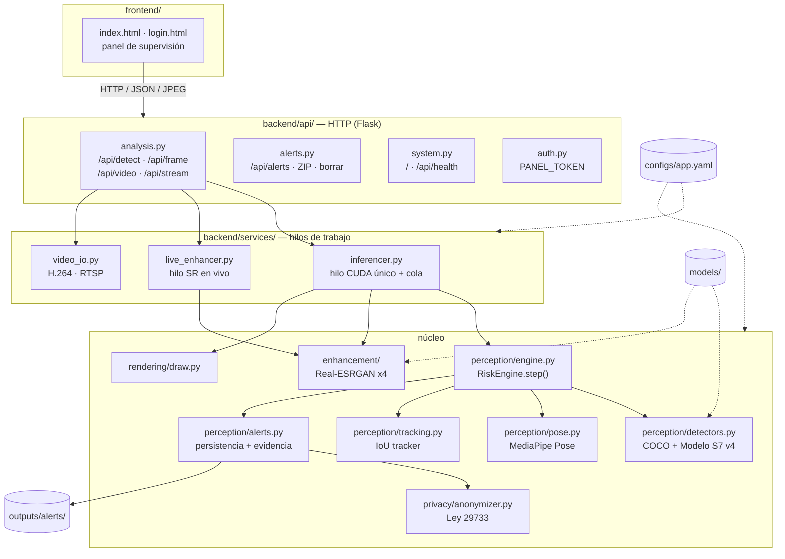
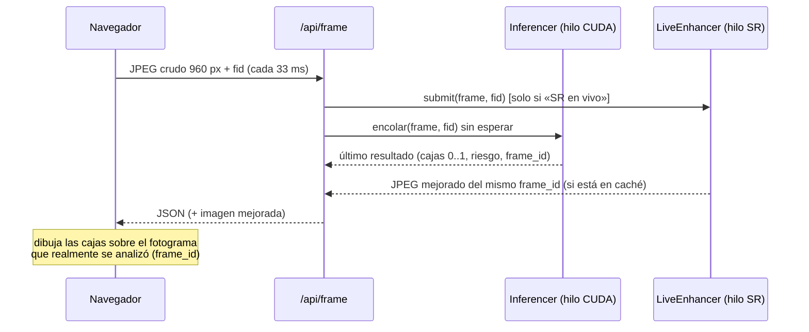

# Sistema de prevención de caídas en escaleras · UPAO

Sistema de visión por computadora que vigila una escalera con una cámara fija y
avisa al personal de seguridad cuando detecta una situación de riesgo:
**caídas, pérdida de equilibrio, tránsito sin usar el pasamanos, distracción con
el celular y objetos abandonados en los escalones**. Incluye un panel web con la
cámara en vivo y una opción de **mejora de calidad de vídeo (Real-ESRGAN x4)**
que funciona de forma fluida en tiempo real.

> Universidad Privada Antenor Orrego · Curso de Percepción Computacional · 2026
> Rama `expo` · Modelo **S7 v4** (release `v1.2.0-escaleras-v4`, definitivo, no se reentrena)


---

## Índice

1. [Qué hace](#1-qué-hace)
2. [Instalación](#2-instalación)
3. [Uso](#3-uso)
4. [Arquitectura del sistema](#4-arquitectura-del-sistema)
5. [Arquitectura de los modelos](#5-arquitectura-de-los-modelos)
6. [Funciones y cómo se implementan](#6-funciones-y-cómo-se-implementan)
7. [Decisiones: qué se implementó, por qué, y qué se descartó](#7-decisiones-qué-se-implementó-por-qué-y-qué-se-descartó)
8. [Privacidad: Ley N.º 29733 y anonimización](#8-privacidad-ley-n-29733-y-anonimización)
9. [Normas ISO/IEC aplicadas](#9-normas-isoiec-aplicadas)
10. [Cumplimiento de requisitos](#10-cumplimiento-de-requisitos)
11. [Estructura del repositorio](#11-estructura-del-repositorio)
12. [API HTTP](#12-api-http)
13. [Pruebas](#13-pruebas)
14. [Datos, créditos y licencias](#14-datos-créditos-y-licencias)
15. [Limitaciones conocidas](#15-limitaciones-conocidas)

---

## 1. Qué hace

| Lo que pide el cliente | Cómo lo resuelve el sistema |
|---|---|
| Ver en la interfaz a las personas caminando por la escalera (cámara en vivo) | Pestaña **Cámara en vivo**: la webcam del navegador (o una cámara IP vía `/api/stream`) se analiza a ~30 fps y las cajas se dibujan sobre el vídeo. |
| Detectar **persona de pie erguida** | Clase `persona_erguida` (riesgo BAJO) por geometría de pose (MediaPipe) o por el detector propio. |
| Detectar **pérdida de equilibrio** | Clase `persona_desequilibrio` + señal `tambaleo` (inclinación del tronco > 12°, asimetría de rodillas). Riesgo ALTO. |
| Detectar **persona distraída** | Señal `distraccion`: mano junto a la cara con cabeza inclinada, o un **celular** (COCO) a menos de 0.14 del rostro. Riesgo MEDIO. |
| Detectar **no uso del pasamanos** | Señal `sin_pasamanos`: ninguna muñeca a la altura de la barandilla y brazo separado del tronco. Riesgo MEDIO. |
| Detectar **anomalías en la escalera** (objetos, estorbos) | YOLOv8s COCO: mochila, bolso, maleta, botella, libro, paraguas → `obstaculo_escalon` (ALTO); mobiliario como contexto. |
| Opción para ver la imagen en vivo **con mejora de calidad** | Casilla **«Mejora de calidad (Real-ESRGAN x4)»**: Real-ESRGAN x4 (`realesr-general-x4v3`) en un hilo propio, ~22 ms por cuadro → el vídeo mejorado se ve fluido (~29 fps medidos). |
| La interfaz debe ser la misma | Mismo plano y mismas pestañas. En el frontend solo se actualizó el texto de la casilla de mejora de calidad; todo lo demás se hizo en el backend. |

Además: alertas con evidencia fotográfica **anonimizada**, registro auditable,
autenticación del panel, estado operativo visible y procesamiento de imágenes y
vídeos pregrabados.

---

## 2. Instalación

Requisitos: **Python 3.10 – 3.12**, Linux / WSL2 / macOS / Windows. GPU NVIDIA
opcional (recomendada, ≥ 6 GB VRAM). Todo se instala **dentro de un entorno
virtual**: no se ensucia el sistema.

### 2.1 Instalación automática (Linux / WSL2)

```bash
git clone https://github.com/AndyHHR1/Video-G-G.git
cd Video-G-G
git checkout expo

scripts/setup.sh            # venv estándar  (.venv)
# o bien
scripts/setup.sh --lambda   # si usas Lambda Stack (reutiliza paquetes del sistema)
# o bien
scripts/setup.sh --cpu      # sin GPU NVIDIA
```

El script detecta la GPU, instala PyTorch correcto, las dependencias, descarga y
verifica (SHA-256) los modelos y ejecuta un diagnóstico.

### 2.2 Instalación manual con **Lambda Stack**

Lambda Stack ya trae CUDA, TensorFlow y un PyTorch de sistema. Se crea el venv
**con acceso a los paquetes del sistema**:

```bash
python3 -m venv --system-site-packages .venv
source .venv/bin/activate
export PYTHONNOUSERSITE=1          # que no se cuelen paquetes de ~/.local

pip install --upgrade pip
pip install --ignore-installed "flatbuffers>=2.0"   # ver nota 1
pip install -r requirements/torch-cu128.txt         # ver nota 2
pip install -r requirements/base.txt
python tools/download_models.py
python tools/check_env.py
```

> **Nota 1 – flatbuffers.** Lambda Stack instala un `flatbuffers` de Debian con
> versión `1.12.1-git…`, que pip ≥ 24.1 rechaza (`invalid-installed-package`).
> Uno válido dentro del venv tiene prioridad y lo resuelve.
>
> **Nota 2 – PyTorch.** El PyTorch de Lambda Stack no trae kernels para GPUs
> **Blackwell (RTX 50xx, `sm_120`)**: `torch.cuda.is_available()` devuelve
> `False`. Por eso se instala `torch 2.11.0+cu128` dentro del venv, que tiene
> prioridad sobre el del sistema. En GPUs anteriores también funciona.
>
> **Nota 3 – TensorFlow del sistema.** mediapipe importa el TensorFlow de Lambda
> Stack y éste carga su propia NCCL; si eso ocurre antes que torch, torch falla
> con `undefined symbol: ncclCommShrink`. El backend importa torch primero
> (`backend/__init__.py`), así que no hay que hacer nada; solo tenerlo en
> cuenta si se escriben scripts propios.

### 2.3 Instalación manual con **venv estándar** (sin Lambda)

Linux / macOS:

```bash
python3 -m venv .venv
source .venv/bin/activate
pip install --upgrade pip
pip install -r requirements/torch-cu128.txt     # GPU NVIDIA
# pip install -r requirements/torch-cpu.txt    # sin GPU (o macOS)
pip install -r requirements/base.txt
python tools/download_models.py
```

Windows (PowerShell):

```powershell
py -3.11 -m venv .venv
.\.venv\Scripts\Activate.ps1
python -m pip install --upgrade pip
pip install -r requirements\torch-cu128.txt     # o requirements\torch-cpu.txt
pip install -r requirements\base.txt
python tools\download_models.py
```

### 2.4 Verificar

```bash
python tools/check_env.py
```

Muestra versiones, GPU, VRAM y el estado (hash) de cada modelo.

---

## 3. Uso

```bash
scripts/run.sh                       # equivalente a: python -m backend
# abrir http://127.0.0.1:5000
```

| Opción | Efecto |
|---|---|
| `--host 0.0.0.0 --port 5000` | Escuchar en la red local (por ejemplo, para verlo desde el celular) |
| `--device cpu` / `--device 0` | Forzar CPU o una GPU concreta (`auto` por defecto) |
| `--sr` / `--no-sr` | Forzar o apagar la mejora Real-ESRGAN (`auto`: activa si hay GPU) |
| `--conf 0.3` | Umbral por defecto del detector |
| `--set clave.sub=valor` | Cambiar cualquier valor de `configs/app.yaml` sin editarlo |
| `--config otro.yaml` | Usar otra configuración (por ejemplo, otra escalera) |

**Autenticación (RQNF19):** si se define `PANEL_TOKEN`, el panel pide ese token.

```bash
PANEL_TOKEN="un-secreto-largo" scripts/run.sh --host 0.0.0.0
```

**Cámara de seguridad IP:** en `configs/app.yaml` → `camera.source:
"rtsp://usuario:clave@ip:554/stream"`, y abrir `http://servidor:5000/api/stream`.

**Pestañas del panel:**

- **Imagen:** analiza una foto (con mejora `RealESRGAN_x4plus` previa si hay GPU). No genera alertas: una foto no es un suceso en el tiempo.
- **Vídeo:** procesa un vídeo completo y lo devuelve anotado en H.264 con su audio. Sí genera alertas (RQNF22).
- **Cámara en vivo:** webcam del navegador. La casilla **«Mejora de calidad (Real-ESRGAN x4)»** activa la mejora en tiempo real (~29 fps).
- **Clases:** leyenda de clases y su relación con los requisitos.

> `getUserMedia` (webcam) solo funciona en un origen seguro: abrir en
> `http://localhost:5000` o servir por HTTPS. Sin HTTPS no hay cifrado: usar
> solo en redes de confianza.

---

## 4. Arquitectura del sistema

### 4.1 Capas

El código está dividido en capas con dependencias en un solo sentido
(arriba → abajo). Ninguna capa inferior conoce a las superiores.



| Capa | Carpeta | Responsabilidad |
|---|---|---|
| Presentación | `frontend/` | Panel web (HTML + JS). No contiene lógica de visión. |
| API | `backend/api/` | Traducir HTTP ↔ llamadas a servicios. Validar entradas. Autenticación. |
| Servicios | `backend/services/` | Concurrencia: hilo de inferencia, hilo de SR en vivo, E/S de vídeo. |
| Percepción | `backend/perception/` | Motor de riesgo: detectores, pose, seguimiento, persistencia, alertas. |
| Mejora | `backend/enhancement/` | Superresolución Real-ESRGAN (arquitecturas en PyTorch puro). |
| Privacidad | `backend/privacy/` | Anonimización de rostros antes de escribir cualquier imagen. |
| Dibujo | `backend/rendering/` | Cajas, etiquetas y codificación JPEG. |
| Configuración | `configs/app.yaml` + `backend/config.py` | Todos los umbrales y rutas, sin tocar código. |

### 4.2 Flujo de la cámara en vivo



Claves del diseño:

- **Un único hilo CUDA para la inferencia.** Flask atiende cada petición en un hilo nuevo y CUDA tiene que reenlazar su contexto en cada uno (medido: 82 ms frente a 29 ms). Todos los modelos viven en un hilo persistente y las peticiones le encolan trabajo.
- **Modo asíncrono en vivo.** La petición devuelve al instante el último resultado y el motor sigue a su ritmo: el navegador nunca espera a la inferencia.
- **La mejora va en paralelo.** La superresolución no pasa por el hilo de detección; corre en su propio hilo y se empareja por `frame_id`.
- **Cadencias coprimas.** Cada etapa se ejecuta cada N fotogramas (pose 8, personas 6, escalera 13, obstáculos 11, clasificación 6) y reutiliza su último resultado entre medias; al ser coprimas casi nunca coinciden en el mismo fotograma y el coste es estable.

### 4.3 Pipeline de `RiskEngine.step()`

```
fotograma ─► 1 personas (YOLOv8s COCO) ──────────────┐
          ─► 2 escalera (Modelo S7 v4) ──────────────┤
          ─► 3 pose (MediaPipe) → señales ───────────┤
          ─► 4 objetos (YOLOv8s COCO) ───────────────┤
                                                     ▼
          5 postura por persona: geometría de pose (si es la persona emparejada)
                                 o recorte → Modelo S7 v4
          6 seguimiento IoU → identidad estable (RQF05)
            caída por recorte: MEDIO «REVISAR» hasta 3 fotogramas seguidos → ALTO
          7 celular junto a la cara → distracción (RQF02-3)
          8 persistencia por severidad + histéresis + cooldown → alerta (RQF06-07)
          9 veredicto BAJO / MEDIO / ALTO + estado OPERATIVO / DEGRADADO
```

### 4.4 Rendimiento medido (RTX 5070 Laptop, 8 GB, WSL2)

| Medida | Valor |
|---|---|
| Motor completo, 4 personas, 960×540 | **34 fps** (p50 27 ms, p95 42 ms) |
| Respuesta de `/api/frame` (asíncrono) | p50 4–5 ms |
| Cámara en vivo con «SR en vivo» | **~29 fps**, imagen mejorada en cada respuesta |
| Real-ESRGAN `general-x4v3`, 480→1920 px, FP16 | 22 ms (FP32: 50 ms) |
| Real-ESRGAN `x4plus`, 640→2560 px, FP16 | 0.78 s (solo imagen fija) |
| SR anterior (ONNX + onnx2torch, 320 px) | ~460 ms → ~2 fps |
| Anonimización de una evidencia | ~15 ms (solo en fotogramas con alerta) |

---

## 5. Arquitectura de los modelos

El sistema combina **cuatro redes**. Solo la primera es propia del proyecto.

### 5.1 Modelo S7 v4 — detector propio (YOLOv8s, 6 clases)

`models/detector/escaleras_s7_v4.pt` · SHA-256 `b6a04f2f…d7ed` · release
[`v1.2.0-escaleras-v4`](https://github.com/AndyHHR1/Video-G-G/releases/tag/v1.2.0-escaleras-v4).
**Es el modelo definitivo: en esta rama no se reentrena ni se modifica.**

| Bloque | Detalle |
|---|---|
| Backbone | CSPDarknet con bloques **C2f** (convoluciones 3×3 + concatenación de gradientes parciales) y **SPPF** al final para campo receptivo amplio. |
| Neck | **PAN-FPN**: fusiona mapas a 3 escalas (strides 8, 16, 32) arriba-abajo y abajo-arriba, para personas cercanas y lejanas. |
| Head | **Anchor-free y desacoplado**: ramas separadas para caja (DFL, *Distribution Focal Loss*) y clase (BCE). |
| Tamaño | 11.1 M parámetros · ~28.6 GFLOPs a 640 px · 22 MB |
| Entrada | 640×640 (letterbox) |
| Clases | `0 persona_caido` · `1 persona_sentado` · `2 persona_erguida` · `3 escalera` · `4 persona` · `5 persona_desequilibrio` |

**Cómo se obtuvo (historia, no se repite aquí):**

1. **Base v3 (`models/base/yolov8s_zoom_v3.pt`)**: YOLOv8s COCO afinado con Fall Detection Dataset, Stairs, MOT15 y Le2i (clase pre-caída), más variantes de primer plano por recorte. Scripts en `training/`.
2. **Fine-tuning v4**: a partir de la base v3, con fotogramas de los vídeos de escaleras UPAO (`data/Escaleras/Estándar` → train/val/test **por vídeo**, sin fuga; `data/Escaleras/Extra` → solo train), pseudo-etiquetados con el modelo base. Configuración en `training/configs/train_escaleras_v4.yaml`: 100 épocas, 640 px, batch 8, `lr0=3e-4` con coseno, `dropout=0.2`, `mixup=0.15`, `cutmix=0.1`, sin `auto_augment`, *early stopping* de 25 épocas.

**Métricas (de `models/detector/escaleras_s7_v4.metrics.json`):**

| Partición | Precision | Recall | **mAP@0.5** | mAP@0.5:0.95 |
|---|---|---|---|---|
| val | 0.665 | 0.786 | **0.776** | 0.635 |
| test | 0.645 | 0.650 | **0.768** | 0.662 |

| Clase | mAP@0.5 val | mAP@0.5 test |
|---|---|---|
| persona_caido | 0.737 | — (no hay ejemplos en test) |
| persona_sentado | 0.551 | 0.995 |
| persona_erguida | 0.728 | 0.698 |
| escalera | 0.989 | 0.995 |
| persona | 0.873 | 0.383 |

RQNF10 (mAP@0.5 > 75 %) **se cumple** en val y en test. Advertencia honesta:
el test de los vídeos UPAO es pequeño y no contiene caídas reales, por eso la
caída se confirma también por **geometría de pose** y nunca solo por el modelo.

### 5.2 YOLOv8s COCO — personas y objetos

`models/coco/yolov8s.pt` (Ultralytics, 80 clases COCO). Misma arquitectura que
5.1. Se usa para **localizar personas** (en escenas reales de escalera el modelo
propio daba 0.08 de confianza donde COCO daba 0.92) y para detectar **objetos
sobre los escalones**. Reparto: *COCO decide dónde hay gente; el Modelo S7 v4
decide qué postura tiene*.

### 5.3 MediaPipe Pose (BlazePose, variante *lite*)

Detector de persona + regresor de **33 puntos corporales** en modo *tracking*
(20 ms frente a 41 ms en modo imagen). Corre en CPU (XNNPACK). De los puntos se
derivan: inclinación del eje tobillo-cadera, altura de la cabeza sobre la
cadera, posición de muñecas respecto a hombros y cara. Umbrales medidos:

| Postura | Regla |
|---|---|
| caído | inclinación > 25° **o** cabeza/eje < 0.55 |
| pérdida de equilibrio | inclinación > 12° **o** cabeza/eje < 0.75 |
| erguido | resto |

### 5.4 Real-ESRGAN x4 — mejora de calidad

Implementadas en PyTorch puro (`backend/enhancement/archs.py`), cargando los
pesos oficiales:

| Modelo | Arquitectura | Parámetros | Uso |
|---|---|---|---|
| `realesr-general-x4v3` | **SRVGGNetCompact**: 32 convoluciones 3×3 + PReLU a la resolución de entrada, `PixelShuffle(4)` y suma residual sobre un reescalado vecino-más-cercano | 1.2 M | **Vídeo en vivo** y vídeos subidos |
| `RealESRGAN_x4plus` | **RRDBNet** (ESRGAN): 23 bloques *Residual-in-Residual Dense*, sin batch-norm, dos etapas de *upsampling* ×2 | 16.7 M | Imagen fija |

Ambas se entrenaron (por sus autores) como generador de una **GAN** con
degradaciones reales sintéticas (desenfoque, ruido, compresión JPEG), por eso
limpian ruido y artefactos de cámara además de ampliar.

**Analogía:** es como pedirle a un dibujante que redibuje un boceto borroso
cuatro veces más grande. No estira píxeles: reconstruye bordes y texturas
plausibles. El «crítico» de la GAN, durante su entrenamiento, le exigió que el
resultado pareciera una foto real.

---

## 6. Funciones y cómo se implementan

| Función | Dónde | Cómo |
|---|---|---|
| Cámara en vivo (RQF01) | `api/analysis.py:/api/frame` | JPEG crudo por petición (sin multipart: −17 ms), inferencia asíncrona. |
| Cámara del servidor / IP | `/api/stream` + `services/video_io.py` | MJPEG; reconexión con espera creciente (RQNF13). |
| Detección de riesgos (RQF02) | `perception/engine.py` | Ver §4.3. |
| Seguro vs riesgo (RQF03) | `engine.py` | BAJO / MEDIO / ALTO por persona y veredicto global. |
| Umbrales (RQF04) | `configs/app.yaml → thresholds` | 0.75 / 0.85 informativos; puerta de alerta 0.35 (ver §7). |
| Seguimiento (RQF05) | `perception/tracking.py` | IoU > 0.25, oclusión 1 s. |
| Persistencia (RQF06) | `perception/alerts.py` | ALTO 1.2 s, MEDIO 0.6 s, histéresis 1 s, cooldown 15 s. |
| Alerta con evidencia (RQF07) | `perception/alerts.py` | Fotograma **anotado y anonimizado** + línea JSON. |
| Panel (RQF08) | `frontend/` + `api/alerts.py` | Lista, borrado individual/selección/todas, ZIP. |
| Mejora de vídeo en vivo | `services/live_enhancer.py` | Hilo propio, FP16, caché por `frame_id`. |
| Mejora de imagen/vídeo subido | `services/inferencer.py` | SR **antes** de detectar (detalles finos para objetos pequeños). |
| Anonimización (RQNF14) | `privacy/anonymizer.py` | Ver §8. |
| Estado del sistema (RQNF09/26) | `/api/health` | OPERATIVO / DEGRADADO / NO OPERATIVO real, no fijo. |
| Autenticación (RQNF19) | `api/auth.py` | Token por variable de entorno, comparación en tiempo constante. |
| Configuración (RQNF21/24) | `configs/app.yaml` | Umbrales, cadencias, modelos, rutas, cámara. |

---

## 7. Decisiones: qué se implementó, por qué, y qué se descartó

### Lo que se implementó

| Decisión | Por qué |
|---|---|
| **No reentrenar el modelo** | El Modelo S7 v4 ya supera RQNF10 (0.776/0.768) y es el entregable estable. Las mejoras de esta rama son de sistema, no de pesos. |
| **Real-ESRGAN `general-x4v3` para el vivo** | Es de la misma familia Real-ESRGAN pero compacto: 22 ms/cuadro frente a ~460 ms de la versión anterior. Permite ver el vídeo mejorado fluido. |
| **Real-ESRGAN `x4plus` para imagen fija** | Máxima calidad cuando no hay prisa (0.78 s por foto). |
| **Arquitecturas en PyTorch puro** en vez de `basicsr`/`realesrgan` | Esos paquetes importan `torchvision.transforms.functional_tensor`, eliminado en torchvision 0.26; romperían el entorno. Son ~100 líneas y cargan los pesos oficiales con `strict=True`. |
| **FP16 en la SR** | Medido: diferencia máxima 2/255 frente a FP32 y el doble de rápido. |
| **SR en hilo propio, emparejada por `frame_id`** | La detección no se frena y las cajas coinciden con la imagen mejorada. |
| **COCO localiza, el modelo propio clasifica** | En escenas reales de escalera COCO encuentra a la persona (0.92) cuando el propio no (0.08). |
| **La geometría de pose manda sobre el recorte** | Medido en test: de pie 64 % vs 31 %, caído 93 % vs 78 %. |
| **Caída por recorte = «REVISAR» hasta 3 fotogramas** | El recorte confundía personas de pie con caídas; sin confirmación temporal no se emite ALTO. |
| **Tracker IoU propio** en vez de ByteTrack | ByteTrack arrastra estado interno entre llamadas de forma frágil; el IoU propio es explícito y suficiente para una cámara fija. |
| **Puerta de alerta 0.35** (no 0.75/0.85) | Las confianzas reales del detector caen entre 0.2 y 0.9 (mediana de caída 0.39): con 0.75 **no salía ninguna alerta**. |
| **Persistencia 1.2 s / 0.6 s** (no > 3 s) | Una caída dura ~1 s; con 3 s solo se avisaba cuando la persona llevaba rato en el suelo. |
| **Flask + hilo único** | Sencillo y suficiente para una cámara; evita el coste de reenlazar CUDA por hilo. |
| **Configuración en YAML** | RQNF21/24: ajustar umbrales, cadencias o la cámara sin tocar código. |

### Lo que se descartó

| Alternativa | Por qué no |
|---|---|
| Reentrenar o ajustar el modelo | Requisito explícito: el modelo es definitivo. |
| ONNX de Real-ESRGAN con onnxruntime / `cv2.dnn` | El ONNX público tiene `scales` en el slot de `roi` del nodo `Resize` y se cuelga. |
| ONNX → `onnx2torch` (versión anterior) | Funcionaba, pero ~460 ms/cuadro: el vivo con SR quedaba a ~2 fps. Reemplazado. |
| RIFE (interpolación de cuadros) | Probado en semanas anteriores; no dio buenos resultados (commit `ea699eb`). Inventa cuadros intermedios, algo indeseable en un sistema de evidencia. |
| `RealESRGAN_x4plus` en vivo | 0.78 s por cuadro: incompatible con tiempo real. |
| `torch.jit` / `torch.compile` | Problemas con `sm_120` y tiempos de compilación largos; FP16 ya basta. |
| FP16 en YOLO | Medido peor en Turing (219 → 504 ms) y sin ganancia en otras GPUs. |
| Mejorar la imagen **antes** de detectar en vivo | Cambia la distribución de entrada del detector en tiempo real y añade latencia; en vivo la SR es solo para visualizar. |
| WebRTC / WebSockets | Más complejo; el JPEG crudo por HTTP ya da ~30 fps en red local. |
| Rediseñar el frontend | Requisito: misma interfaz (solo se actualizó un texto). |

---

## 8. Privacidad: Ley N.º 29733 y anonimización

Las imágenes de personas son **datos personales** según la **Ley N.º 29733,
Ley de Protección de Datos Personales** del Perú, y su tratamiento mediante
cámaras está regulado además por la **Directiva N.º 01-2020-JUS/DGTAIPD**
(tratamiento de datos personales mediante sistemas de videovigilancia). El
detalle completo está en [`docs/normativa.md`](docs/normativa.md).

Cómo lo aplica el sistema:

| Principio / obligación | Implementación |
|---|---|
| **Finalidad** (Art. 6): solo para seguridad | El sistema solo detecta riesgos de caída; no identifica personas ni hace reconocimiento facial. |
| **Proporcionalidad** (Art. 7) | No se graba el vídeo: solo se guarda **un fotograma por alerta**. |
| **Anonimización / disociación** | Antes de escribir cualquier imagen se pixelan los rostros: MediaPipe Face (corto y largo alcance) en la imagen completa **y en el recorte de cada persona**; si aun así no aparece la cara, se pixela la zona de la cabeza. Se prefiere anonimizar de más. |
| **Conservación limitada** | Evidencias: 7 días o 200 imágenes como máximo (configurable, por debajo del plazo general de la Directiva). |
| **Seguridad** (Art. 16) | Panel con token (`PANEL_TOKEN`), rutas de imágenes protegidas contra *path traversal*, evidencias fuera del repositorio (`outputs/` en `.gitignore`). |
| **Supresión** | Borrado de alertas individual o total desde el panel (imagen y registro juntos). |
| **Información al titular** | Obligación del despliegue: cartel informativo de zona videovigilada en la escalera (Directiva 01-2020). |

> Ningún vídeo ni imagen real de personas se versiona en el repositorio.

---

## 9. Normas ISO/IEC aplicadas

Las normas ISO son de adopción voluntaria; en este proyecto son **obligatorias
por exigencia del documento de requisitos (ERS)** del curso. Detalle y evidencias en
[`docs/normativa.md`](docs/normativa.md).

| Norma | Tema | Dónde se refleja |
|---|---|---|
| **IEEE 830 / ISO/IEC/IEEE 29148** | Especificación de requisitos | `docs/Caso.md`, informe en `docs/informe/` |
| **ISO/IEC 25010:2023** (familia **25000 SQuaRE**) | Modelo de calidad del producto | Matriz §10: cada requisito trazado a una característica |
| **ISO/IEC 42001:2023** | Sistema de gestión de IA | Trazabilidad de inferencias (`alertas.jsonl`), modelo versionado con hash, decisiones documentadas |
| **ISO/IEC 23894:2023** | Gestión de riesgos de IA | Falsos positivos/negativos analizados (§7), confirmación temporal, «REVISAR» |
| **ISO/IEC 22989:2022** | Conceptos y terminología de IA | Glosario del informe |
| **ISO/IEC TR 24028:2020** | Confiabilidad de la IA | Robustez a iluminación (augmentations HSV), estado DEGRADADO explícito |
| **ISO/IEC 27001:2022** | Seguridad de la información | Autenticación, secretos fuera del repo, control de acceso a evidencias |
| **ISO/IEC 27701** · **ISO/IEC 29100** | Privacidad | Minimización y anonimización (§8) |
| **ISO/IEC 20889** | Técnicas de desidentificación | Pixelado de rostros como técnica de enmascaramiento |
| **ISO 8000** · **ISO/IEC 5259-3** | Calidad de datos para IA | Partición por vídeo (sin fuga), auditoría de datasets (`training/audit_datasets.py`) |

---

## 10. Cumplimiento de requisitos

| Req. | Descripción | Estado |
|---|---|---|
| RQF01 | Captura continua de vídeo | **Cumple** — webcam del navegador y cámara IP |
| RQF02 | 4 categorías de riesgo | **Cumple** — obstáculos (COCO), pasamanos, distracción, caída/desequilibrio |
| RQF03 | Seguro vs riesgo | **Cumple** |
| RQF04 | Umbrales 75 % / 85 % | **Parcial** — configurables; la puerta de alerta usa 0.35 (§7) |
| RQF05 | Seguimiento con oclusión 1 s | **Cumple** — tracker IoU propio |
| RQF06 | Persistencia temporal | **Desviación consciente** — 1.2 s / 0.6 s (§7) |
| RQF07 | Alertas con evidencia | **Cumple** — evidencia anotada y anonimizada |
| RQF08 | Panel de supervisión | **Cumple** |
| RQNF01 | ≥ 30 fps | **Cumple en GPU** — 34 fps medidos (RTX 5070); en CPU ~7 fps |
| RQNF02 | Latencia < 500 ms | **Cumple** — respuesta 4–5 ms, motor 27 ms |
| RQNF03 | GPU ≥ 6 GB | **Cumple** (verificado por `tools/check_env.py`) |
| RQNF09 / RQNF26 | Estado operativo real | **Cumple** — `/api/health` |
| RQNF10 | mAP@0.5 > 75 % | **Cumple** — val 0.776, test 0.768 |
| RQNF12 | Resiliencia a iluminación | **Cumple** — augmentations HSV; SR limpia ruido |
| RQNF13 | Reconexión automática | **Cumple** — navegador (5 reintentos) y RTSP |
| RQNF14 | Protección de datos | **Cumple** — §8 |
| RQNF15 / 16 / 18 | Integridad, auditoría, no repudio | **Cumple** — imagen + línea JSON escritas juntas |
| RQNF19 | Autenticación | **Cumple** — token compartido (no hay usuarios/roles) |
| RQNF20 | Arquitectura modular | **Cumple** — §4.1 |
| RQNF21 / 24 | Configuración externa | **Cumple** — `configs/app.yaml` |
| RQNF22 | Pruebas con vídeo pregrabado | **Cumple** — pestaña Vídeo |
| RQNF23 | Diagnóstico | **Cumple** — `/api/health`, `tools/check_env.py`, logs |
| RQNF25 | Escalable a multicámara | **Preparado** — servicios desacoplados; una cámara en V1 |
| RQNF11 / 27 | Horario / sin actuadores | Dependen del despliegue; el sistema es pasivo |

---

## 11. Estructura del repositorio

```
Video-G-G/
├── README.md                  este documento
├── backend/                   servidor (Python)
│   ├── __main__.py            entrada: python -m backend
│   ├── app.py                 fábrica Flask: une capas y servicios
│   ├── config.py              carga de configs/app.yaml (dataclasses)
│   ├── api/                   rutas HTTP: analysis, alerts, system, auth
│   ├── services/              inferencer (hilo CUDA), live_enhancer (SR), video_io
│   ├── perception/            engine, detectors, pose, tracking, alerts, catalog
│   ├── enhancement/           Real-ESRGAN: archs + super_resolution
│   ├── privacy/               anonimización de rostros
│   └── rendering/             dibujo y codificación
├── frontend/templates/        panel web
├── configs/app.yaml           configuración de ejecución
├── models/                    pesos (ver models/README.md)
├── requirements/              base · torch-cu128 · torch-cpu · dev
├── scripts/                   setup.sh · run.sh · get_dataset.sh
├── tools/                     download_models · check_env · render_architecture
├── tests/                     unitarias + humo de la API
├── training/                  scripts y configs con los que se entrenó (histórico)
├── data/                      datos fuera del repo: dataset de Hugging Face y vídeos (ver data/README.md)
└── docs/                      informe Word, requisitos, normativa, decisiones, diagramas
```

---

## 12. API HTTP

| Ruta | Método | Descripción |
|---|---|---|
| `/` | GET | Panel |
| `/api/health` | GET | Estado, GPU, modelos, SR, autenticación |
| `/api/detect` | POST | `file` (imagen) + `conf` → detecciones + imagen anotada (hex) |
| `/api/frame` | POST | JPEG crudo; query `conf`, `overlay`, `sr`, `fid` → cajas 0..1 (+ imagen mejorada en base64 si `sr=1`) |
| `/api/video` | POST | `file` (vídeo) → MP4 H.264 anotado con audio |
| `/api/stream` | GET | MJPEG de la cámara del servidor (`?cam=` índice o URL) |
| `/api/cameras` | GET | Cámaras locales del servidor |
| `/api/alerts` | GET | Últimas 100 alertas con URL de evidencia |
| `/api/alerta-imagen/<día>/<archivo>` | GET | Imagen de evidencia |
| `/api/alertas.zip` | GET | ZIP con evidencias + registro |
| `/api/alertas` | DELETE | Borra todas, o `{"ids": [...]}` |
| `/login` | GET/POST | Acceso con `PANEL_TOKEN` |

---

## 13. Pruebas

```bash
pip install -r requirements/dev.txt     # opcional (pytest)
python -m unittest discover -s tests -t .   # o: pytest tests
```

- `tests/test_units.py`: configuración, tracker, geometría de pose, persistencia y escritura de alertas (sin GPU).
- `tests/test_api_smoke.py`: arranca la app completa con los modelos reales y prueba `/api/health`, `/api/detect`, `/api/frame` (con SR) y las rutas de alertas. Se salta si faltan los pesos.

La refactorización se validó además comparando el motor nuevo con el de la
rama `semana-7` sobre la misma secuencia: salidas **idénticas** (ver
`docs/decisiones.md`).

---

## 14. Datos, créditos y licencias

| Recurso | Uso | Licencia / origen |
|---|---|---|
| [Ultralytics YOLOv8](https://github.com/ultralytics/ultralytics) | Detector y pesos COCO | AGPL-3.0 |
| [MediaPipe](https://github.com/google-ai-edge/mediapipe) | Pose y detección de rostros | Apache-2.0 |
| [Real-ESRGAN](https://github.com/xinntao/Real-ESRGAN) (X. Wang et al., ICCVW 2021) | Superresolución | BSD-3-Clause |
| [Fall Detection Dataset](https://www.kaggle.com/datasets/uttejkumarkandagatla/fall-detection-dataset) | caído / sentado | Kaggle |
| [Stairs](https://www.kaggle.com/datasets/samuelayman/stairs) | escalera | Kaggle |
| [MOT15](https://www.kaggle.com/datasets/mdraselsarker/mot15-challenge-dataset) | persona | Kaggle |
| [Le2i Fall Detection](https://github.com/YifeiYang210/Fall_Detection_dataset) | pérdida de equilibrio | uso académico |
| [`andres31416/stairs_fallhuman`](https://huggingface.co/datasets/andres31416/stairs_fallhuman) | dataset unificado (fall, stairs, tracking), repositorio aparte | Hugging Face · `scripts/get_dataset.sh` |
| Vídeos de escaleras UPAO | fine-tuning v4 | propios, no se distribuyen |

Los datasets pertenecen a sus autores y se usan solo con fines académicos.

---

## 15. Limitaciones conocidas

- Las señales de pasamanos y distracción son **reglas sobre keypoints** calibradas con pocas escenas; no hay ground truth público para medirlas.
- MediaPipe Pose describe **una persona por fotograma**; con varias personas, las señales de pose se asignan a la que mejor encaja.
- El test del Modelo S7 v4 no contiene caídas reales; la confirmación de caída se apoya en la geometría de pose.
- El servidor de Flask es de un solo proceso (adecuado para una cámara). Sin HTTPS no hay cifrado.
