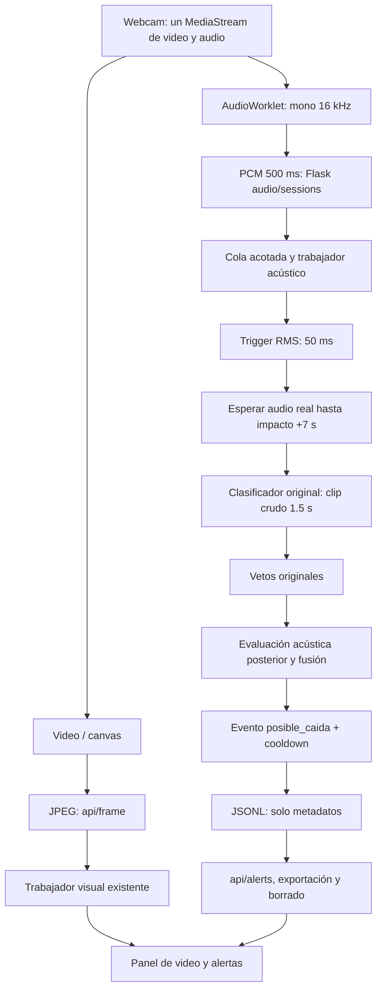

# Informe de integración de detección de posibles caídas por audio

Fecha de trabajo: 16 de octubre de 2026, zona del usuario America/Lima.

## 1. Resumen ejecutivo

Se integró el detector acústico existente en la webcam en vivo de `Video-G-G`.
El navegador entrega imágenes al motor visual y PCM de la misma captura a un
trabajador acústico independiente. Las posibles caídas se registran y muestran
en el panel existente. La detección no necesita resultados del motor visual.

Se migraron el modelo y componentes acústicos reales. Se corrigieron problemas
de temporización, compatibilidad NumPy y correspondencia entre entrenamiento
e inferencia. No se entrenó ningún modelo, no se modificó el proyecto de origen
y no se efectuaron commits ni despliegues.

La integración está implementada y se validó con señales sintéticas, pruebas
automatizadas y la aplicación real con YOLO/MediaPipe en CPU. Su uso con una
cámara física, audio de un entorno real y GPU requiere validación adicional;
no se atribuyen resultados clínicos o de campo a estas pruebas.

## 2. Análisis del proyecto original

La carpeta disponible es `C:\proyects\Modulo-imagen-vid` (la solicitud escribe
también `Modulo-imagen-vide`). Contiene Python, Flask, HTML/JavaScript,
Ultralytics/OpenCV/MediaPipe para visión y un paquete acústico separado con
una API opcional FastAPI. Había cambios locales y archivos acústicos sin
seguimiento al comenzar; se respetaron.

Se comprobaron estas implementaciones:

- `audio_fall_detector/preprocess.py`: lectura/mono/remuestreo a 16 kHz,
  Butterworth de 80 Hz, reducción de ruido, normalización y buffer circular.
- `trigger.py`: RMS en 50 ms contra mediana ambiental de cinco segundos,
  factor 4,8, piso RMS 0,015 y separación mínima de impactos de 1,5 s.
- `classifier.py`: características espectrales Mel/MFCC/contraste, vector de
  2048 componentes y cabeza MLP de seis clases con calibración sigmoidea.
  Puede cargar PANNs si existen pesos externos; sin ellos usa el extractor
  espectral implementado. No se encontraron pesos PANNs en el paquete migrado.
  Si falta la cabeza clasificadora, el código original devuelve valores de una
  heurística: esos valores no constituyen probabilidades calibradas verificadas.
- `models/fall_classifier.joblib`: artefacto real de 19.522.691 bytes,
  scikit-learn 1.9.1, seis clases: caída, portazo, objeto que cae, pasos,
  voz/TV y ruido. Su configuración declara `panns`, pero el extractor tiene un
  fallback espectral. La configuración por sí sola no demuestra que se haya
  entrenado con CNN14. Aquí se usa explícitamente el extractor espectral y
  se comprueba el artefacto con señales sintéticas del generador original.
- `confirm.py`: pYIN en 180–850 Hz y energía posterior al impacto. El intervalo
  real configurado es de +1 a +7 segundos, aunque algunos comentarios originales
  dicen +3 a +10. Voz tonal no demuestra una petición de auxilio, ni silencio
  demuestra inmovilidad de una persona.
- `decision.py`: fusión `0,65 * p_caida + 0,35 * índice_posterior`, umbrales
  0,48/0,68 y veto si portazo/objeto alcanza 0,58. El nombre interno heredado
  `CAIDA_CONFIRMADA` solo expresa un umbral del algoritmo; no se publica como
  una caída confirmada. La regla técnica correspondiente se publica como
  `UMBRAL_ACUSTICO_ALTO_SUPERADO`. Originalmente podía guardar clips WAV.
- `pipeline.py`: admite archivos y chunks, pero el streaming evalúa el audio
  posterior inmediatamente y usa timestamps absolutos sobre un buffer relativo.
  Por ello no se reutilizó ese orquestador sin corregirlo.
- `train.py` y `dataset.py`: entrenamiento sobre clips crudos y generación de
  muestras sintéticas. No se encontró evidencia de evaluación de campo que
  justifique las afirmaciones de producción o bajas falsas alarmas del README
  original. El generador produce señales de referencia, no caídas humanas reales.
- `percepcion_sonido_escaleras.py`: otra implementación de análisis acústico
  por reglas, simulación, gráficos y exportación de características. No es
  necesaria para la cadena elegida; no se duplicó en la aplicación.
- `app/sound_alerts.py`: reproduce pitidos de aviso; **no detecta** caídas por
  sonido. `app/modulo_imagen/`, `risk_engine.py` y los modelos YOLO realizan
  procesamiento **visual**, separado del detector acústico.

## 3. Análisis del proyecto destino

`Video-G-G` es una aplicación Flask. `app/server.py` contiene los endpoints y
un trabajador persistente `Inferencer` para YOLO/motor de riesgo. Puede aplicar
Real-ESRGAN opcional. La interfaz está en `app/templates/index.html`.

La webcam se captura con `getUserMedia({video, audio})`. El video se muestra
localmente y se envían JPEG a `/api/frame` para inferencia asíncrona. Antes de
esta integración, la pista de audio solo se reproducía localmente: **los JPEG
no contienen audio** y el servidor no recibía ninguna señal acústica.

`stopCam`, el cambio de pestaña y `beforeunload` administran el cierre. Las
alertas visuales se consultan por `/api/alerts`; existen exportación ZIP,
borrado y autenticación opcional mediante `PANEL_TOKEN`. Se reutilizan estos
controles. No había una suite automatizada de pruebas en destino; el workflow
existente prepara releases, no pruebas.

Los videos subidos pasan por un flujo batch y se recodifican conservando su
pista de audio cuando existe. `/api/stream` entrega MJPEG de una cámara del
servidor mediante OpenCV. Ninguno de esos dos modos se conecta al análisis
acústico nuevo: el modo integrado es **webcam en vivo del navegador**.

## 4. Archivos migrados o reutilizados

Rutas de origen relativas a `Modulo-imagen-vid`; destinos a `Video-G-G`.

| Origen | Destino | Función/adaptación |
|---|---|---|
| `audio_fall_detector/trigger.py` | misma ruta | Disparador original sin cambios |
| `audio_fall_detector/preprocess.py` | misma ruta | Filtro y buffers reutilizados |
| `audio_fall_detector/classifier.py` | misma ruta | Extractor/cabeza originales; carga compatible e importación diferida de Torch |
| `audio_fall_detector/confirm.py` | misma ruta | Evaluación acústica posterior original sin cambios |
| `audio_fall_detector/decision.py` | misma ruta | Reglas originales; no crear carpeta de clips si el guardado está desactivado |
| `audio_fall_detector/config.yaml` | misma ruta | Configuración original preservada; overrides de ejecución separados |
| `audio_fall_detector/models/fall_classifier.joblib` | misma ruta | Modelo original idéntico byte por byte |
| `audio_fall_detector/dataset.py` | misma ruta | Generador sintético para pruebas; no se usa como detector |
| `audio_fall_detector/pipeline.py` (concepto) | `audio_fall_detector/streaming.py` | Orquestador corregido para audio continuo |
| `audio_fall_detector/api.py` (protocolo de audio) | `app/audio_live.py` | Adaptación HTTP dentro del Flask existente; sin segundo servidor FastAPI |

SHA-256 del joblib, igual en origen y destino:
`68527b88f75142693c56ee798f981611febb5d25fd46316e6c799aca7e2eb9da`.

## 5. Modificaciones realizadas

- `audio_fall_detector/streaming.py`: filtro causal con estado, dos buffers
  circulares de 20 s (crudo y filtrado), ventanas reales pendientes y cooldown
  de 30 s para **todas** las alertas acústicas. El original solo lo aplicaba a
  su estado de umbral alto.
- Se conserva el tamaño de clasificación de 1,5 s. `train.py` usa clips crudos
  directamente; aplicar filtrado/normalización a esas entradas redujo la salida
  de caída del ensayo de 0,7442 a valores muy inferiores. El adaptador entrega
  señal cruda al clasificador y usa la filtrada para trigger/evaluación posterior.
  Retrocede 50 ms desde el timestamp de fin del bloque disparador, en lugar de
  los 300 ms originales, para alinear el comienzo del clip con el entrenamiento.
  Se documenta como adaptación de inferencia, no como mejora de precisión real.
- `audio_fall_detector/model_compat.py`: el joblib utiliza constructores/estado
  de RNG de NumPy 2, incompatibles con la carga directa en NumPy 1.26. Un
  deserializador local adapta esos nombres/estados sin parchear NumPy globalmente,
  cambiar arrays del modelo ni reentrenarlo.
- `app/audio_live.py`: sesiones con UUID, hasta cuatro simultáneas, cola de cuatro
  bloques, validación de PCM y secuencias, registro JSONL protegido por lock,
  trabajador independiente y limpieza cada dos segundos tras 15 s sin audio.
  La cabeza del modelo se comparte; el procesamiento acústico se serializa y
  BLAS se limita a un hilo durante ese procesamiento.
  También conserva el cooldown en el reloj de la sesión cuando un hueco de audio
  obliga a reiniciar los buffers del detector.
  En el arranque normal `main()` se precalientan carga del modelo, características
  y kernels pYIN antes de abrir el servidor para evitar esa compilación durante
  el primer evento en vivo. Un fallo de precalentamiento no impide iniciar video.
- `app/static/audio-worklet.js`: mezcla mono y remuestreo a 16 kHz fuera del hilo
  de interfaz, paquetes transferibles float32 LE de 8000 muestras (500 ms).
- `app/static/audio-live.js`: usa pistas del `MediaStream` existente, administra
  recursos/errores/permisos, una petición de PCM en vuelo, mute/desconexión,
  suspensión de AudioContext y cancelación de generaciones anteriores.
- `app/templates/index.html`: activación/estado acústico, alertas sin porcentajes
  de certeza, cierre coordinado y protección frente a callbacks de cámaras
  antiguas. Se solicita desactivar AGC/supresión de ruido/cancelación de eco
  de captura, cuando el dispositivo lo respete. El monitoreo local comienza
  silenciado para evitar realimentación; el usuario puede usar sus controles.
- `app/server.py`: registra el blueprint; combina alertas acústicas/visuales,
  exportación y borrado. Real-ESRGAN pasa a importarse al activar su uso: permite
  probar Flask/audio sin instalar toda la pila visual y conserva su uso normal.
- `requirements-audio.txt`, `requirements.txt`, `setup.sh`: dependencias acústicas
  e instalación en el mismo entorno. Se fija scikit-learn 1.9.1 y se mantiene
  NumPy <2 para MediaPipe. No se agrega FastAPI, Uvicorn, PANNs, TensorFlow,
  servicios externos ni una segunda instalación de PyTorch para audio.
- `tests/`, scripts de diagnóstico/prueba, documentación y `.gitignore`: pruebas,
  datos sintéticos locales reproducibles y exclusión de entornos temporales.

Overrides de ejecución: ruta absoluta del modelo, backend espectral, offset de
50 ms y `save_event_clip=False`. Los demás umbrales principales se conservan.
La heurística de respaldo del clasificador heredado no puede habilitar el
detector en vivo: un modelo ausente/incompatible se informa como error.

## 6. Funcionamiento de la integración

1. Al conectar la webcam se obtiene video y, si el permiso/dispositivo lo permite,
   audio. Si falla la captura conjunta se conserva el fallback a video sin audio.
2. Se inspecciona esa pista de audio. Sin ella, sin AudioWorklet o con error,
   se informa la falta de cobertura y el video continúa.
3. AudioWorklet produce PCM mono a 16 kHz. Se solicita una sesión al Flask
   existente y se envía un bloque de 500 ms por petición, sin almacenar archivos.
4. El servidor valida longitud, amplitud finita, secuencia y offset. La recepción
   encola y responde; no espera la clasificación. Si se satura la cola, descarta
   audio y lo indica. Los saltos de offset reinician el contexto para no confundir
   audio faltante con silencio ni unir muestras no contiguas.
5. El disparador RMS examina bloques de 50 ms. Solo sus candidatos pasan a
   clasificación. Se esperan los siete segundos posteriores **recibidos**.
6. El clasificador usa 1,5 s de señal cruda. Los vetos originales descartan
   portazos/objetos y baja salida de caída antes de ejecutar el análisis pYIN.
   Los candidatos restantes usan el intervalo posterior real y la fusión original.
7. Si se alcanza el umbral, se genera `type=posible_caida`, `source=audio`, fecha
   UTC, ID de transmisión, offset de impacto e información técnica. No se publica
   `CAIDA_CONFIRMADA`, identidad de persona ni confianza de caída real. Los scores
   técnicos son resultados internos, no una probabilidad clínica validada.
8. El panel existente consulta `/api/alerts` cada tres segundos y muestra:
   **«ALERTA: Se ha detectado un sonido compatible con una posible caída.»**
   Incluye la transmisión y el instante aproximado dentro del audio.
9. Al detener, reiniciar o cambiar de pestaña se desconecta el grafo de audio,
   se cierran AudioContext y sesión, se vacía la cola y se impide publicar resultados
   pendientes. Una inferencia ya ejecutándose termina y libera sus buffers; no
   se fuerza la terminación de un hilo Python. Tras un cierre abrupto, el TTL
   limpia la sesión. Las pistas se detienen desde el ciclo de vida de la cámara.

Rutas nuevas (heredan la autenticación `PANEL_TOKEN`):

| Método y ruta | Función |
|---|---|
| `POST /api/audio/sessions` | Crear sesión; el modelo carga en el trabajador |
| `GET /api/audio/sessions/<id>` | Estado, RMS, bloques procesados/descartados y coste del último bloque |
| `POST /api/audio/sessions/<id>/chunks` | 32000 bytes PCM float32 LE, con `X-Audio-Sequence` y `X-Audio-Offset` |
| `POST /api/audio/sessions/<id>/stop` | Detener; idempotente |

## 7. Arquitectura final



El transporte de video y audio es independiente pero parte de la misma captura.
El offset se obtiene del contador de muestras de audio desde el primer bloque
aceptado y se vincula a la sesión. Es aproximado: no equivale al tiempo desde
que se pulsó conectar, no se atribuye a un frame de inferencia ni se fusiona
con la visión.

## 8. Pruebas ejecutadas

Entorno aislado: Ubuntu/WSL, Python 3.12.3, NumPy 1.26.4, SciPy 1.17.1,
scikit-learn 1.9.1, librosa 0.11.0, Flask 3.1.3 y OpenCV headless 4.10.0.84.
Pruebas JavaScript: Node 22.20.0. Navegador: Chrome instalado en Windows,
controlado por Playwright local. Para la prueba conjunta se añadió al entorno
temporal PyTorch 2.6.0+cpu, torchvision 0.21.0+cpu, Ultralytics 8.4.170,
MediaPipe 0.10.21 y protobuf 4.25.9. No se instaló el stack GPU/ESRGAN.
Los audios de prueba son sintéticos y permanecen locales.

### Comandos

```bash
# Entorno temporal usado; también se puede omitir AUDIO_TEST_ENV para .venv-audio
AUDIO_TEST_ENV=/tmp/video-g-g-audio-20261016 bash scripts/setup_audio_test_env.sh
AUDIO_TEST_ENV=/tmp/video-g-g-audio-20261016 bash scripts/run_audio_checks.sh
node --test tests/audio-worklet.test.cjs
node --check app/static/audio-live.js
node --check app/static/audio-worklet.js
python scripts/probe_audio_model.py
python scripts/verify_audio_model_compat.py
# Comparación independiente usando NumPy 2 en un directorio temporal:
PYTHONPATH=/tmp/video-g-g-audio-numpy2 python scripts/verify_audio_model_compat.py --native
```

La preparación descargó paquetes públicos de PyPI; no se transfirió audio
a servicios externos. La instalación inicial sobre `/mnt/c` fue demasiado lenta
y se detuvo; las pruebas finales usan el entorno temporal Linux. `npm.ps1` fue
bloqueado por la política de scripts de Windows; se utilizó `npm.cmd` sin cambiar
esa política. El primer acceso de npm a red dentro del sandbox falló; la
instalación aislada con el permiso del entorno sí se completó.

### Resultados automatizados

- Suite Python final: **21/21 pruebas pasaron en 19,62 s**, incluyendo el
  precalentamiento sin crear sesiones/archivos. La suite anterior de 20 casos
  también pasó antes y después de instalar la pila CPU visual.
  Cubre sesiones, eventos, reinicio, validación PCM, pérdida
  de paquetes, silencio, cola saturada, cierre durante inferencia, expiración,
  errores de carga, autenticación, panel, ZIP/borrado y endpoint visual simulado.
- Pruebas temporales con clasificador controlado verifican que no se evalúe el
  futuro, que haya una sola alerta y que reset libere el historial.
- El modelo **real** se prueba con las seis clases del generador original,
  semilla 42, en una sesión sintética de 13 segundos. La caída genera una sola
  alerta; portazo, objeto, pasos, voz/TV y ruido no generan alertas en esos casos.
  No se generaliza a otras grabaciones.
- Worklet: **5/5 pruebas pasaron**, incluyendo frecuencia/duración/secuencia
  a 16, 44,1, 48 y 96 kHz y cliente sin audio. También pasó la comprobación de
  sintaxis de ambos scripts y del JavaScript inline de la plantilla.
- SHA-256 del modelo idéntico en ambas carpetas. Hash de las matrices de pesos
  e interceptos, igual con carga nativa y compatible:
  `7d7620cb8a007ddf93863224c27cbec4ad25892fe1898fe7ce9e1d53e8031678`.
  Las predicciones de dos vectores deterministas difieren menos de `1e-6`
  entre NumPy 2.5.4 y 1.26.4. No hubo cambio de pesos.
- Diagnóstico final, caída sintética: `p_caida=0,7461`, índice posterior 0,222,
  índice de fusión 0,563 e impacto a 2,05 s. Es evidencia de funcionamiento del
  ensayo, no una confianza de caída real.
- Chrome/AudioWorklet/HTTP con video simulado: **prueba integral satisfactoria**,
  con **461 frames**
  enviados, sin errores JavaScript. Se verificaron procesamiento real de PCM,
  cierre de la sesión anterior, reinicio con un ID nuevo, video que continúa al
  desactivar audio y ausencia de pista. Una señal sintética de impacto acompañada
  de un tono vocal posterior produjo el evento con el modelo real y el texto
  exacto de alerta en el panel. La inferencia visual y los dispositivos eran
  simulados. La primera señal de impacto aislado no generó alerta en el navegador:
  el modelo es sensible al alineamiento y al remuestreo; esto se conserva como
  limitación, no se oculta como una detección satisfactoria. La prueba directa
  del impacto aislado en Python sí pasó.
  Capturas locales: `.test-runtime/audio-smoke.png`,
  `.test-runtime/audio-positive.png` y `.test-runtime/audio-last.png`.
- Aplicación real en CPU: **prueba integral satisfactoria**, iniciando
  `app/server.py` con los pesos existentes y MediaPipe, sin interceptar
  `/api/frame`. En el ensayo final con precalentamiento se enviaron
  **258 frames**; **256 respuestas** incluyeron
  tiempos de inferencia mayores que cero (pueden reutilizar el último resultado
  asíncrono; **no son 256 inferencias diferentes**). La salud del servidor
  reportó `OPERATIVO`, CPU y seis clases. El modelo acústico real generó una
  alerta de la sesión actual, visible en el panel; se validaron cierre y
  reinicio. No hubo errores JavaScript.
  La sesión del impacto procesó 23 bloques sin descartes; el último bloque
  reportó 34 ms. La transmisión inicial también reportó cero descartes tras el
  precalentamiento. Un ensayo previo sin precalentamiento había enviado 564 frames.
  La fuente de cámara/audio era simulada por Chrome: **los dos motores eran reales**.
  El evento sintético creado en el registro normal se eliminó por su ID mediante
  la API al terminar; las capturas de evidencia permanecen en `.test-runtime`.
- Rendimiento con YOLO real en CPU: las ventanas de tres segundos variaron
  entre ensayos. El primero dio **15,61 frames/s enviados con audio frente a
  14,97 sin audio**; el último, **2,66 con audio frente a 3,32 sin audio**.
  Durante la fase que incluyó la alerta del último ensayo se enviaron **6,35
  frames/s**. Estas son cadencias de envío, no de inferencias nuevas.
  **No se puede garantizar ausencia de degradación significativa** con estas
  ventanas cortas y variables. La CPU compartida y el costo visual limitan la
  fluidez; se requiere una comparación prolongada y controlada en el equipo de uso.
  Antes del precalentamiento se observaron 15 bloques descartados en el arranque
  y una bajada transitoria en la primera evaluación pesada. Se adelantó carga/JIT
  al inicio del servidor; el ensayo final tuvo cero descartes, pero esto no prueba
  estabilidad de FPS ni ausencia de pérdidas en otros escenarios.
- Microdiagnóstico acústico final con librerías calientes, seis sesiones
  sintéticas: medianas por bloque de 500 ms de aproximadamente **0,66–1,09 ms**,
  máximo observado **19,53 ms**. No incluye carga inicial del modelo ni un caso
  exigente de pYIN vocal; no sustituye la prueba conjunta.

### Fallos detectados y corregidos

1. Carga directa joblib: `ValueError: ... is not a known BitGenerator module`.
   Se resolvió con el adaptador de serialización descrito, comprobando pesos
   y predicciones contra NumPy 2. No se actualizó NumPy del módulo visual.
2. Las ventanas filtradas/desplazadas rechazaban incluso las muestras sintéticas
   de caída originales. Se reprodujo con el generador, se inspeccionó `train.py`
   y se alineó la inferencia con clips crudos y su comienzo. El umbral no se bajó.
3. En pruebas de navegador se ajustaron las esperas para consultar condiciones
   HTTP de forma explícita y esperar la actualización periódica del panel.
   No se considera una prueba de alerta válida sin observar el evento y su texto.

### Alcance de las pruebas solicitadas

| Caso | Verificación y límite |
|---|---|
| Video normal | Endpoint simulado y aplicación con YOLO/MediaPipe reales en CPU; fuente de Chrome simulada, sin prueba GPU |
| Activación | Sesiones HTTP y captura AudioWorklet del navegador |
| Sonido de caída | Modelo original y señal sintética; evento y panel verificados también con YOLO real simultáneo |
| Sonido normal | Tres señales de control y cinco clases sintéticas no caída; no garantiza cero falsos positivos reales |
| Sin audio | Cliente sin pista no crea detector ni solicita otro micrófono; no bloquea video |
| Detención | Cierre, cola vacía y descarte de eventos tardíos comprobados |
| Reinicio | Sesión nueva y eliminación de la anterior; sin reutilizar buffers |
| Rendimiento | Coste y ventanas comparativas en CPU ejecutados; fluidez variable, no se acredita ausencia de degradación; falta prueba controlada física/GPU |

No se ejecutó una caída humana real, no se capturaron personas y no se midió
una tasa de falsas alarmas por hora. No existían pruebas anteriores en destino.

## 9. Limitaciones

- El modelo y los generadores recuperados no acreditan rendimiento en caídas
  humanas reales. Se requieren grabaciones representativas y evaluación separada
  de las muestras de entrenamiento. Puede haber falsos positivos y negativos.
- La corrección de ventanas hace ejecutable el modelo heredado, pero no elimina
  la fragilidad de un clasificador aprendido con clips sintéticos. Los distintos
  suelos, distancias, micrófonos, ganancia y ruido pueden cambiar el resultado.
- Una caída silenciosa, micrófono desconectado o un impacto fuera de cobertura
  pueden pasar inadvertidos. Silencio no significa que el detector esté cubriendo
  el ambiente correctamente; la interfaz lo comunica.
- pYIN detecta periodicidad vocal, no semántica de auxilio. Los scores heredados
  de confirmación/fusión no están calibrados para población o habitación real.
- Retardo mínimo aproximado: siete segundos posteriores + bloque/red/cola/
  procesamiento + hasta tres segundos de consulta del panel. Si termina antes
  el audio, se descarta el candidato incompleto.
- AudioWorklet requiere localhost/HTTPS y un navegador compatible. Permisos
  denegados y restricciones de dispositivos reducen la cobertura acústica.
- Los saltos de red/saturación reinician el contexto y pueden causar omisiones.
  El límite de cuatro sesiones y la serialización acústica priorizan recursos
  acotados; no se validó capacidad multiusuario ni varios procesos WSGI.
- El procesamiento acústico en otro hilo evita esperar la clasificación en la
  ruta de recepción, pero comparte CPU/GIL con Flask y visión. El precalentamiento
  reduce trabajo frío; no elimina contención de CPU ni garantiza FPS constantes.
- El remuestreo del Worklet usa integración por áreas; no equivale a un
  remuestreador de estudio con filtro antialias diseñado para todos los espectros.
- Un flujo remoto debe proporcionar una pista de audio accesible. MJPEG no la
  incluye. Esta aplicación no tiene captura de audio de URLs remotas; CORS,
  autenticación y restricciones del origen impedirían capturarlo arbitrariamente.
  No se abre un micrófono independiente para simular ese audio.
- Los metadatos JSONL persisten y se pueden exportar/borrar. El audio ocupa solo
  buffers en memoria; la aplicación no crea grabaciones nuevas por las detecciones.

## 10. Estado final

La implementación acústica es **funcional e integrada**, verificada con pruebas
unitarias, HTTP y de navegador, incluyendo YOLO/MediaPipe reales en CPU junto
al detector acústico original. La validación de campo es **parcial**: quedan
cámara/micrófono físicos, GPU/ESRGAN y pruebas prolongadas en el equipo y entorno
de uso, especialmente rendimiento bajo carga: las mediciones CPU fueron variables.
No se presenta el sistema como detector clínico ni como solución de
precisión validada en personas.

## 11. Instrucciones de ejecución

Usar el entorno existente del módulo de video (Python 3.11/3.12 recomendado):

```bash
cd Video-G-G
./venv/bin/python -m pip install -r requirements-audio.txt
./venv/bin/python app/server.py --weights runs/yolov8s_zoom/weights/best.pt --device auto
```

En un entorno Windows con Python instalado, el equivalente del intérprete es
`.\venv\Scripts\python.exe`. Para instalar desde cero el sistema de video,
seguir `setup.sh`, que detecta CPU/GPU y ahora incluye audio. El fichero principal
de requisitos tiene restricciones CUDA/Linux ya existentes; no debe asumirse
que todas esas wheels se instalen directamente en cualquier Windows.

1. Abrir `http://localhost:5000`, iniciar sesión si se configuró `PANEL_TOKEN`.
2. Abrir **Cámara en vivo** y pulsar **Conectar webcam**. Autorizar la captura
   conjunta de video/audio si se desea cobertura acústica.
3. Mantener marcada **Analizar audio para posibles caídas**. Verificar el estado
   «Analizando audio de esta transmisión». Si está suspendido, pulsar
   **Reanudar audio**. Sin pista, revisar permisos/dispositivo; el video sigue.
4. Una alerta aparece en el panel de alertas con su texto y transmisión. No
   provocar caídas de personas para probarlo: usar señales sintéticas o muestras
   de prueba autorizadas. La acústica de un parlante añade otra limitación al ensayo.
5. **Detener**, desmarcar el análisis o cambiar de pestaña cierra el análisis.
   En caso de error acústico, resolver la dependencia/modelo y volver a habilitarlo.

Para repetir las pruebas sin instalar el stack visual completo:

```bash
bash scripts/setup_audio_test_env.sh
bash scripts/run_audio_checks.sh
node --test tests/audio-worklet.test.cjs
# Para ejecutar diagnósticos Python con ese entorno:
source .venv-audio/bin/activate
```

Prueba de navegador, dos terminales locales (requiere Chrome instalado):

```bash
npm.cmd install --prefix .test-runtime --no-audit --no-fund playwright
# Terminal 1, con el entorno de pruebas de Python:
python scripts/make_audio_smoke_fixture.py
python scripts/serve_audio_smoke.py
# Terminal 2, Node en Windows:
node tests/audio-browser-smoke.cjs
```

`serve_audio_smoke.py` es solo un servidor temporal local sin cargar YOLO y con
registro aislado en `.test-runtime`; no es el arranque de producción. El test
simula dispositivos y respuestas visuales, conserva el detector acústico real
y genera capturas locales para inspección. `.test-runtime` y los entornos de
prueba están ignorados por Git.

La comprobación adicional de video real utilizó este arranque (WSL/Linux,
entorno CPU temporal ya instalado):

```bash
OMP_NUM_THREADS=2 MKL_NUM_THREADS=2 OPENBLAS_NUM_THREADS=1 \
python app/server.py --weights runs/yolov8s_zoom/weights/best.pt \
  --obstacle-weights yolov8s.pt --device cpu --port 5058
```

Y en PowerShell/Node:

```powershell
$env:SMOKE_REAL_VIDEO='1'
$env:SMOKE_BASE_URL='http://localhost:5058'
node tests/audio-browser-smoke.cjs
```

Capturas: `.test-runtime/audio-real-video-smoke.png` y
`.test-runtime/audio-real-video-positive.png`. No se activó ESRGAN. MediaPipe
descargó su pequeño modelo de pose durante el arranque; no se subió audio.
Los avisos EGL/DRI3 de WSL no impidieron iniciar el motor en CPU.

## 12. Recomendaciones

Validar con audios reales autorizados de varias habitaciones y dispositivos,
separados por sesión/persona de entrenamiento; medir sensibilidad, precisión,
falsas alarmas por hora, latencia y FPS antes/después de activar audio.
Revisar calibración y datos de entrenamiento antes de atribuir probabilidades.
Considerar una entrada remota autenticada con audio real si ese modo se requiere,
mejor filtrado antialias, despliegue con un gestor de sesiones compartido y
retención acotada de metadatos. Estas mejoras no se implementaron fuera del alcance.
